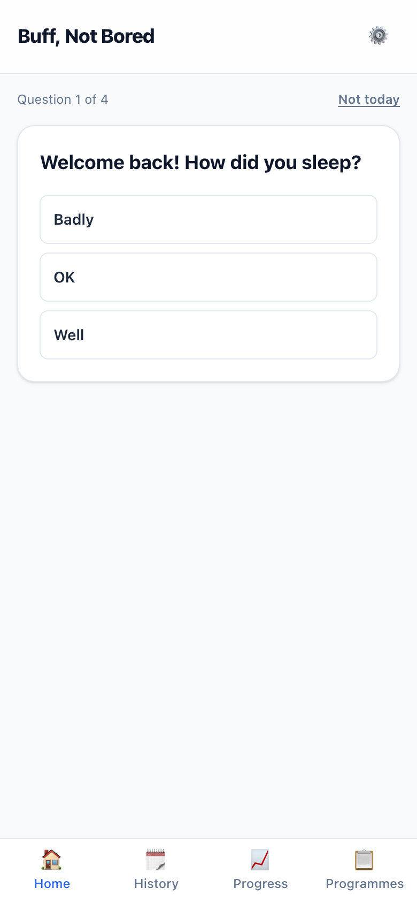
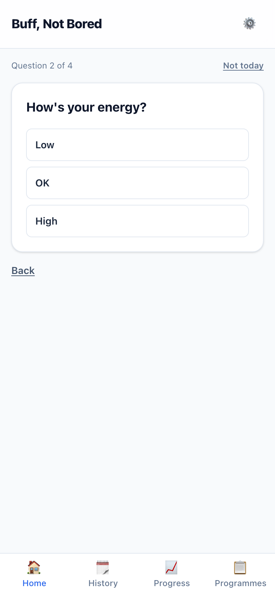
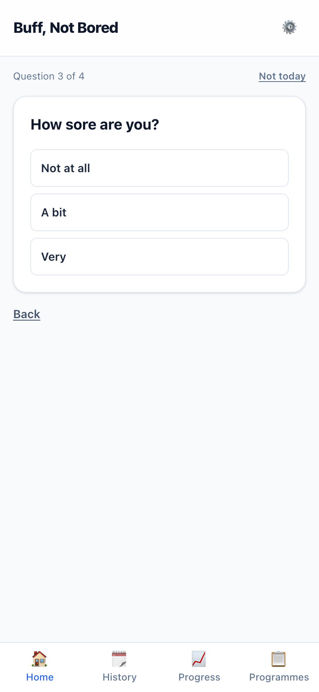
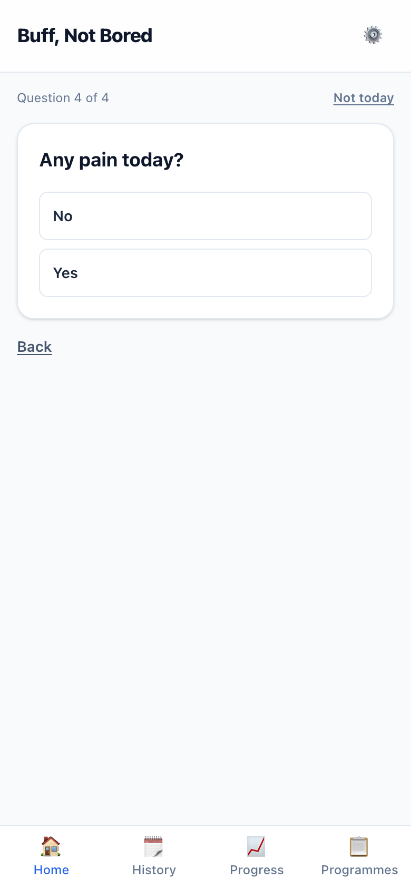
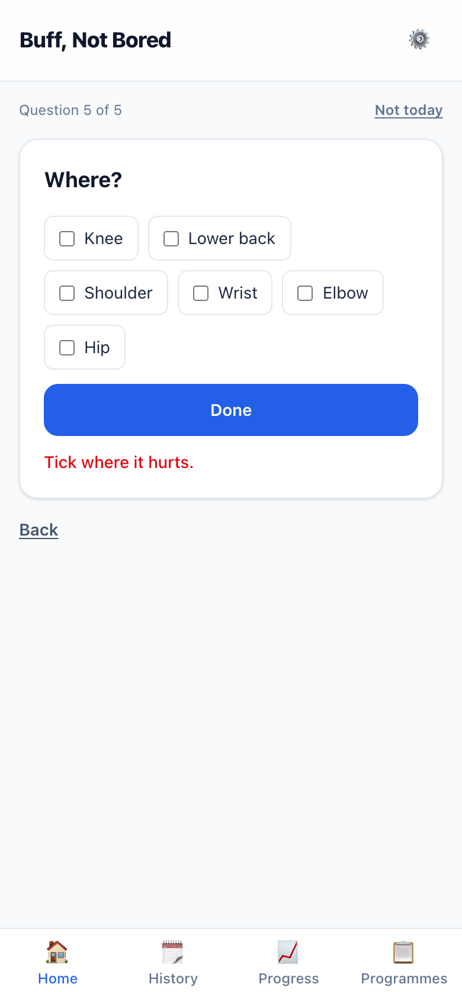
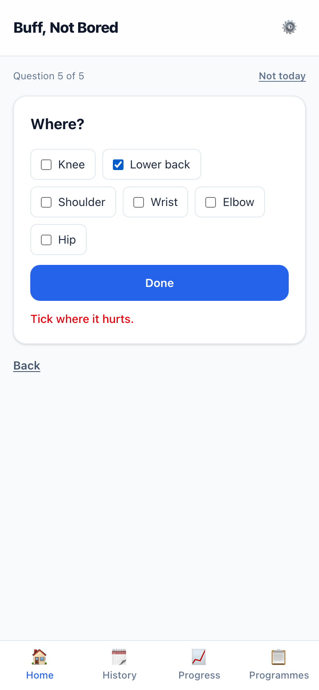
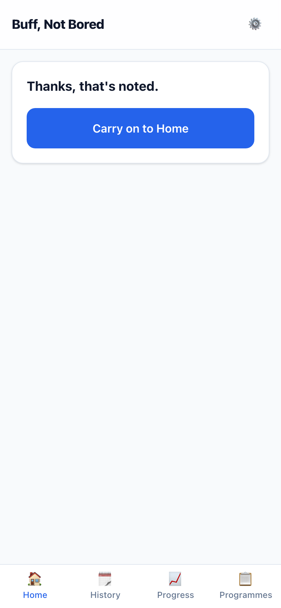
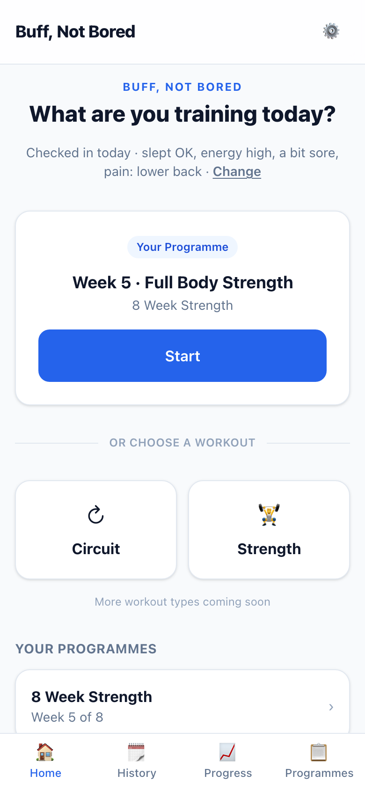
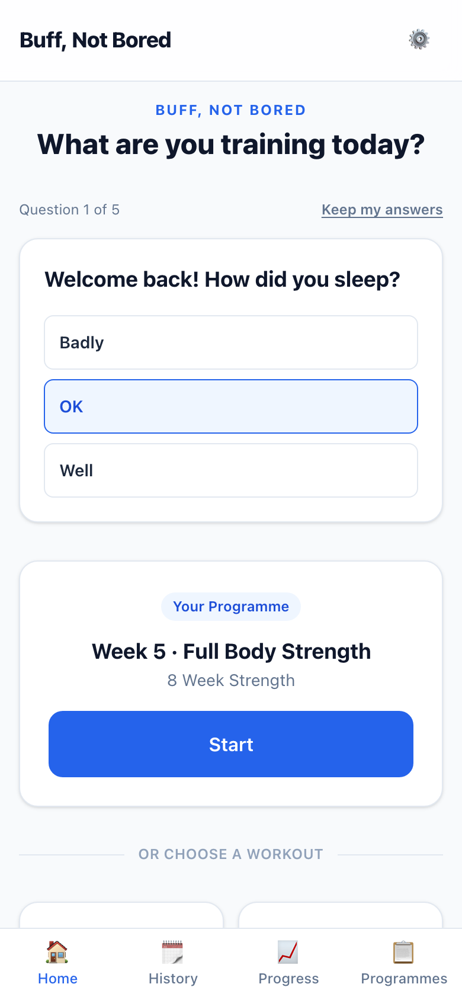
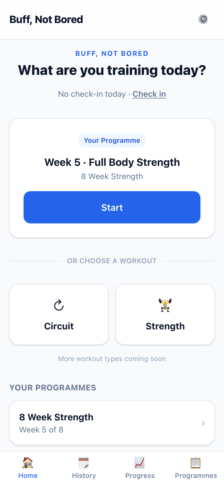

# S-016 · How are you today? The check-in

## What was built
- **Once you're set up, your first visit to Home each day opens with a check-in.** One tap per question:
  1. **How did you sleep?** Badly · OK · Well
  2. **How's your energy?** Low · OK · High
  3. **How sore are you?** Not at all · A bit · Very
  4. **Any pain today?** No · Yes. If yes, **Where?** (knee, lower back, shoulder, wrist, elbow, hip, any of them), then Done.
- **"Not today"** skips it, and it won't ask again that day.
- **Then Home shows how you checked in:** "Checked in today · slept OK, energy high, a bit sore, pain: lower back · **Change**". After "Not today" it says "No check-in today · **Check in**".
- **Nothing adapts yet.** Offering a light day after poor answers, and swapping exercises away from a painful area, come in **S-018**.
- **No check-in on the day you first set up.** It starts the next day, so a brand-new user isn't "welcomed back" minutes after setting up.

## Screenshots (390 × 844, in flow order)

| | |
|---|---|
|  | **01 · First visit of the day:** how did you sleep? |
|  | **02 · Energy.** |
|  | **03 · Soreness.** |
|  | **04 · Any pain today?** |
|  | **05 · Where?** Done with nothing ticked asks you to tick an area. |
|  | **06 · Lower back ticked** (question 5 of 5). |
|  | **07 · Thanks, that's noted.** |
|  | **08 · Home** with today's check-in and Change. |
|  | **09 · Changing today's answers:** starts from what you said. |
|  | **10 · After "Not today":** "No check-in today · Check in". |

## Placeholder UI (design-first)
Home is design-first, so this is **proposed, not designed**: plain cards and buttons. The wording, in `apps/web/lib/check-in-copy.ts`, is mine, for you to rewrite.

## Things to know
- **"Today" is the calendar day of the computer running the app.** That's right while it runs on your Mac. If the app is ever hosted, it should use your phone's date instead (noted in the backlog).
- **The rest of Home is unchanged** until your Home design.

## Data
- **Schema change (approved):** a new `check_ins` table, one row per day. After pulling, run `prisma generate` and `prisma migrate deploy`.

## Questions for you
None.
