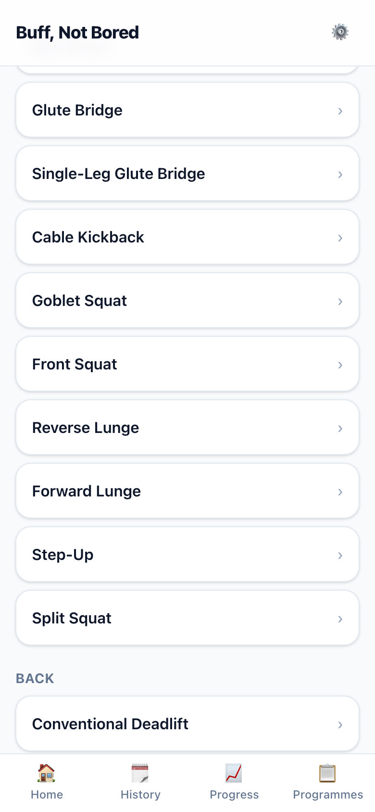
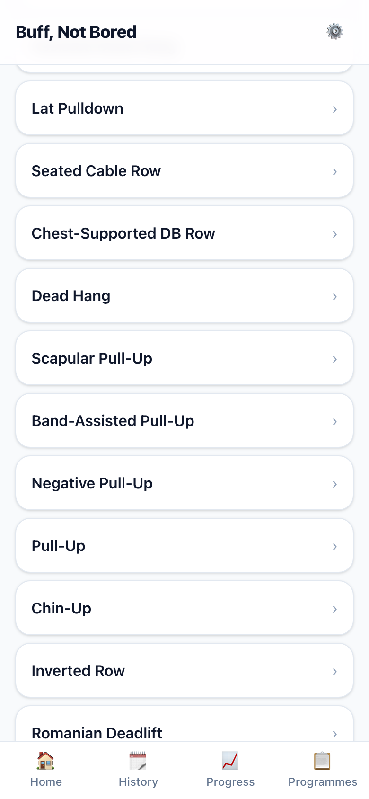
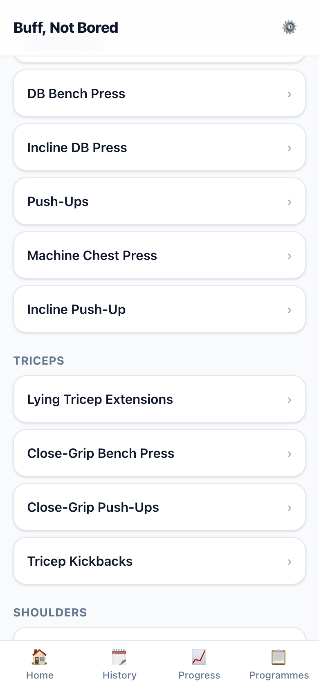
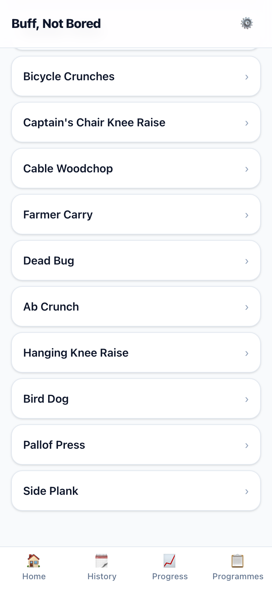
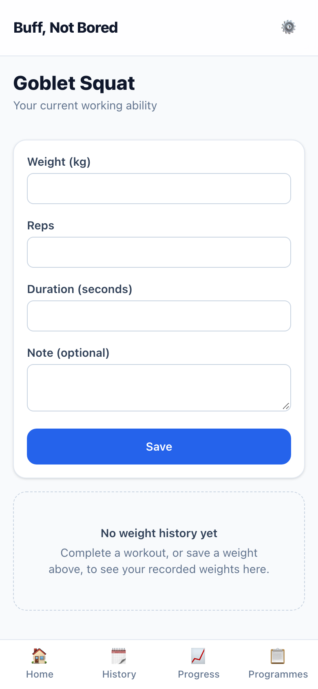
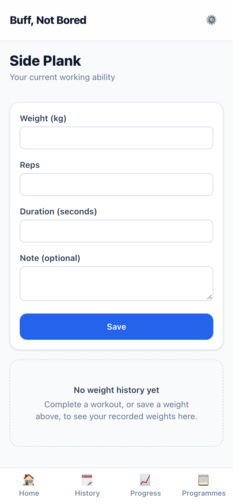

# S-009 · Library additions for the generator

## What was built
- **31 new exercises**, the rest of the §10.2 starter library:
  - **Pull-up ladder:** dead hang, scapular pull-up, band-assisted pull-up, negative pull-up, pull-up, chin-up.
  - **Rows:** inverted row, face pull.
  - **Hinge and glutes:** Romanian deadlift (barbell and dumbbell), back extension, hip thrust, glute bridge, single-leg glute bridge, cable kickback.
  - **Squat and lunge:** goblet squat, front squat, reverse and forward lunge, step-up, split squat.
  - **Push:** machine chest press, incline push-up, seated DB shoulder press, machine shoulder press.
  - **Core:** dead bug, ab crunch, hanging knee raise, bird dog, Pallof press, side plank.
- **Every one has the full details:** muscles, pattern, compound or isolation, equipment and station, weight jumps (from 0.25 kg), how it's counted, cues, swap group and joint-stress tags.
- **Light alternatives** everywhere a lighter version exists in the same pattern, including on existing exercises (Back Squat → Goblet Squat or Leg Press, and so on).
- **The pull-up ladder is linked** (§10.3): dead hang → scapular pull-up → band-assisted (or machine-assisted) pull-up → negative → pull-up.
- **Nothing changes in your workouts.** Preset 1 and Circuit use the same exercises as before.

## What this unlocks for the generator
- **Dumbbells (and a bench) only:** every pattern now has options except vertical pull, which needs a pull-up bar, band or cable. The generator will record that as an explained gap (D-016).
- **A knee limitation:** squat and lunge are out (every one stresses the knee), but hinge and glute work cover the lower body, which satisfies §6.4's "knee-dominant *or* hip-dominant".
- 32 of 75 exercises still have no lighter version. They're mostly already the lightest in their pattern, so the light day uses "one fewer set" for those (D-016).

## Screenshots (390 × 844)

| | |
|---|---|
|  | **01 · Exercises, legs:** goblet squat, front squat, the lunges, glute work. |
|  | **02 · Back:** the pull-up ladder, inverted row, Romanian deadlifts. |
|  | **03 · Chest and shoulders:** machine presses, incline push-up, seated DB press. |
|  | **04 · Core:** dead bug, ab crunch, hanging knee raise, bird dog, Pallof press, side plank. |
|  | **05 · An exercise page** (Goblet Squat). |
|  | **06 · A timed exercise page** (Side Plank). |

## Check the details
These are my proposed values. The **joint-stress tags** matter most: they decide what a limitation rules out.

| Exercise | Muscles | Pattern | Class | Needs | Counted in |
|---|---|---|---|---|---|
| Dead Hang | forearms, lats, (upper back) | vertical pull | isolation | pull up bar | seconds |
| Scapular Pull-Up | lats, upper back, (trapezius) | vertical pull | isolation | pull up bar | reps |
| Band-Assisted Pull-Up | lats, upper back, (biceps), (forearms) | vertical pull | compound | pull up bar, band | reps |
| Negative Pull-Up | lats, upper back, (biceps), (forearms) | vertical pull | compound | pull up bar | reps |
| Pull-Up | lats, upper back, (biceps), (forearms) | vertical pull | compound | pull up bar | reps |
| Chin-Up | lats, biceps, (upper back), (forearms) | vertical pull | compound | pull up bar | reps |
| Inverted Row | upper back, lats, (biceps), (rear deltoids) | horizontal pull | compound | barbell, rack | reps |
| Face Pull | rear deltoids, upper back, (trapezius) | horizontal pull | isolation | cable | reps |
| Romanian Deadlift | hamstrings, glutes, (spinal erectors) | hinge | compound | barbell, rack | reps |
| DB Romanian Deadlift | hamstrings, glutes, (spinal erectors) | hinge | compound | dumbbells | reps |
| Back Extension | spinal erectors, glutes, (hamstrings) | hinge | isolation | machine | reps |
| Hip Thrust | glutes, (hamstrings) | hip extension | compound | barbell, bench | reps |
| Glute Bridge | glutes, (hamstrings) | hip extension | isolation | bodyweight | reps |
| Single-Leg Glute Bridge | glutes, (hamstrings) | hip extension | isolation | bodyweight | reps per side |
| Cable Kickback | glutes, (hamstrings) | hip extension | isolation | cable | reps per side |
| Goblet Squat | quads, glutes, (adductors) | squat | compound | dumbbells | reps |
| Front Squat | quads, (glutes), (abdominals) | squat | compound | barbell, rack | reps |
| Reverse Lunge | quads, glutes, (hamstrings), (adductors) | lunge unilateral | compound | dumbbells | reps per side |
| Forward Lunge | quads, glutes, (hamstrings), (adductors) | lunge unilateral | compound | dumbbells | reps per side |
| Step-Up | quads, glutes, (hamstrings) | lunge unilateral | compound | dumbbells, bench | reps per side |
| Split Squat | quads, glutes, (adductors) | lunge unilateral | compound | dumbbells | reps per side |
| Machine Chest Press | chest, (anterior deltoids), (triceps) | horizontal push | compound | machine | reps |
| Incline Push-Up | chest, (triceps), (anterior deltoids) | horizontal push | compound | bench | reps |
| Seated DB Shoulder Press | anterior deltoids, lateral deltoids, (triceps) | vertical push | compound | dumbbells, bench | reps |
| Machine Shoulder Press | anterior deltoids, lateral deltoids, (triceps) | vertical push | compound | machine | reps |
| Dead Bug | abdominals, (hip flexors) | anti extension | isolation | bodyweight | reps per side |
| Ab Crunch | abdominals | anti extension | isolation | bodyweight | reps |
| Hanging Knee Raise | abdominals, (hip flexors), (forearms) | anti extension | isolation | pull up bar | reps |
| Bird Dog | abdominals, spinal erectors, (glutes) | anti rotation | isolation | bodyweight | reps per side |
| Pallof Press | obliques, abdominals | anti rotation | isolation | cable | reps per side |
| Side Plank | obliques, (abdominals), (glutes) | lateral flexion | isolation | bodyweight | seconds per side |

| Exercise | Jumps | Progression | Light alternative | Swap group | Joint stress | Ladder |
|---|---|---|---|---|---|---|
| Dead Hang | – | ladder | – | hang | shoulder | → Scapular Pull-Up |
| Scapular Pull-Up | – | ladder | – | hang | shoulder | ← Dead Hang → Band-Assisted Pull-Up |
| Band-Assisted Pull-Up | – | ladder | – | band-assisted-pull-up | shoulder, elbow | ← Scapular Pull-Up → Negative Pull-Up |
| Negative Pull-Up | – | ladder | Band-Assisted Pull-Up | vertical-pull | shoulder, elbow | ← Band-Assisted Pull-Up → Pull-Up |
| Pull-Up | – | ladder | Band-Assisted Pull-Up | vertical-pull | shoulder, elbow | ← Negative Pull-Up |
| Chin-Up | – | ladder | Band-Assisted Pull-Up | vertical-pull | shoulder, elbow | ← Negative Pull-Up |
| Inverted Row | – | ladder | – | horizontal-pull | shoulder | – |
| Face Pull | +0.25 / +0.5 / +1 / +2.5 / +5 kg | double progression | – | face-pull | shoulder | – |
| Romanian Deadlift | +0.25 / +0.5 / +1 / +2.5 / +5 kg | load nudge | DB Romanian Deadlift | hinge | lower back, hip | – |
| DB Romanian Deadlift | +0.25 / +0.5 / +1 / +2 / +2.5 kg | load nudge | Back Extension | hinge | lower back, hip | – |
| Back Extension | – | ladder | Superman Holds | back-extension | lower back | – |
| Hip Thrust | +0.25 / +0.5 / +1 / +2.5 / +5 kg | load nudge | Glute Bridge | hip-extension | hip | – |
| Glute Bridge | – | ladder | – | hip-extension | – | → Single-Leg Glute Bridge |
| Single-Leg Glute Bridge | – | ladder | Glute Bridge | hip-extension | hip | ← Glute Bridge |
| Cable Kickback | +0.25 / +0.5 / +1 / +2.5 / +5 kg | double progression | Glute Bridge | hip-extension | hip | – |
| Goblet Squat | +0.25 / +0.5 / +1 / +2 / +2.5 kg | load nudge | Bodyweight Squat Pulses | squat | knee, hip | – |
| Front Squat | +0.25 / +0.5 / +1 / +2.5 / +5 kg | load nudge | Goblet Squat | squat | knee, wrist, lower back | – |
| Reverse Lunge | +0.25 / +0.5 / +1 / +2 / +2.5 kg | load nudge | Split Squat | lunge | knee, hip | – |
| Forward Lunge | +0.25 / +0.5 / +1 / +2 / +2.5 kg | load nudge | Reverse Lunge | lunge | knee, hip | – |
| Step-Up | +0.25 / +0.5 / +1 / +2 / +2.5 kg | load nudge | Split Squat | lunge | knee | – |
| Split Squat | +0.25 / +0.5 / +1 / +2 / +2.5 kg | load nudge | – | lunge | knee | – |
| Machine Chest Press | +0.25 / +0.5 / +1 / +2.5 / +5 kg | load nudge | Incline Push-Up | horizontal-push | shoulder | – |
| Incline Push-Up | – | ladder | – | horizontal-push | wrist, shoulder | → Push-Ups |
| Seated DB Shoulder Press | +0.25 / +0.5 / +1 / +2 / +2.5 kg | load nudge | Machine Shoulder Press | vertical-push | shoulder | – |
| Machine Shoulder Press | +0.25 / +0.5 / +1 / +2.5 / +5 kg | load nudge | – | vertical-push | shoulder | – |
| Dead Bug | – | ladder | – | anti-extension | – | – |
| Ab Crunch | – | ladder | Dead Bug | trunk-flexion | – | – |
| Hanging Knee Raise | – | ladder | Captain's Chair Knee Raise | trunk-flexion | shoulder, lower back | – |
| Bird Dog | – | ladder | – | anti-rotation | wrist | – |
| Pallof Press | +0.25 / +0.5 / +1 / +2.5 / +5 kg | double progression | Bird Dog | anti-rotation | – | – |
| Side Plank | – | ladder | – | lateral-flexion | shoulder | – |

**Existing exercises with new links**

| Exercise | Light alternatives now | Ladder |
|---|---|---|
| Back Squat | Bodyweight Squat Pulses, Goblet Squat, Leg Press | – |
| Conventional Deadlift | Superman Holds, DB Romanian Deadlift | – |
| DB Bench Press | Push-Ups, Machine Chest Press | – |
| Overhead Press | Seated DB Shoulder Press, Machine Shoulder Press | – |
| Lunges (Alternating) | Split Squat | – |
| Bulgarian Split Squat | Split Squat | – |
| Hip Thrust Machine | Glute Bridge | – |
| Plank | Dead Bug | – |
| Push-Ups | Incline Push-Up | ← Incline Push-Up |
| Assisted Pull-Up | – | ← Scapular Pull-Up → Negative Pull-Up |

**Cues**
- **Dead Hang.** Take an overhand grip on the bar, hands just wider than your shoulders. Hang with long arms and relaxed shoulders. Grip hard and breathe steadily.
- **Scapular Pull-Up.** Hang from the bar with straight arms. Pull your shoulder blades down and back without bending your elbows. Lower slowly to a full hang.
- **Band-Assisted Pull-Up.** Loop a band over the bar and put one knee or foot in it. Pull your chest towards the bar. Lower all the way to straight arms.
- **Negative Pull-Up.** Step or jump up so your chin is over the bar. Lower yourself slowly, over 3 to 5 seconds. Keep your shoulders down as you lower.
- **Pull-Up.** Hang from the bar with an overhand grip, hands just wider than your shoulders. Pull until your chin clears the bar. Lower all the way with control.
- **Chin-Up.** Hang from the bar with an underhand grip, hands shoulder-width. Pull until your chin clears the bar. Lower all the way with control.
- **Inverted Row.** Set a bar at waist height in the rack and hang underneath it, body straight. Pull your chest to the bar. Keep your body in one straight line.
- **Face Pull.** Set a rope at head height and step back until your arms are straight. Pull the rope towards your face, hands splitting apart. Squeeze your shoulder blades, then return slowly.
- **Romanian Deadlift.** Stand tall holding the bar at your hips, soft knees. Push your hips back until you feel your hamstrings stretch. Keep the bar close to your legs and your back flat.
- **DB Romanian Deadlift.** Stand tall with a dumbbell in each hand in front of your thighs. Push your hips back, sliding the dumbbells down your legs. Keep your back flat and stand up by squeezing your glutes.
- **Back Extension.** Set the pad just below your hips, feet locked in. Lower with a flat back, then rise until your body is straight. Don't over-arch at the top.
- **Hip Thrust.** Sit with your upper back against a bench, bar over your hips (padded). Drive through your heels until your hips are level. Squeeze your glutes at the top; keep your ribs down.
- **Glute Bridge.** Lie on your back, knees bent, feet flat and hip-width apart. Press through your heels to lift your hips. Squeeze your glutes at the top, then lower slowly.
- **Single-Leg Glute Bridge.** Lie on your back, one foot flat, the other leg straight up or out. Press through the planted heel to lift your hips. Keep your hips level.
- **Cable Kickback.** Attach an ankle strap to a low cable and face the stack. Kick your leg back, squeezing your glute. Keep your body still; don't arch your back.
- **Goblet Squat.** Hold one dumbbell upright at your chest, feet shoulder-width. Sit down between your heels, chest up. Push your knees out over your toes.
- **Front Squat.** Rest the bar on the front of your shoulders, elbows high. Keep your elbows up and chest tall. Sit straight down, knees over toes.
- **Reverse Lunge.** Stand tall with a dumbbell in each hand. Step back and lower your back knee towards the floor. Push through your front heel to stand.
- **Forward Lunge.** Stand tall with a dumbbell in each hand. Step forward and lower your back knee towards the floor. Push back to standing through your front heel.
- **Step-Up.** Stand facing a bench or box, a dumbbell in each hand. Step up and drive through the top foot to stand tall. Step down slowly; don't push off the bottom foot.
- **Split Squat.** Stand in a long split stance, a dumbbell in each hand. Lower straight down until your back knee nearly touches the floor. Keep your front shin fairly upright.
- **Machine Chest Press.** Set the seat so the handles line up with the middle of your chest. Press forward until your arms are straight but not locked. Return slowly until you feel a stretch.
- **Incline Push-Up.** Hands on a bench, slightly wider than your shoulders, body straight. Lower your chest to the bench. Keep your body in one straight line.
- **Seated DB Shoulder Press.** Sit on an upright bench, dumbbells at shoulder height. Press up until your arms are straight. Keep your back against the bench.
- **Machine Shoulder Press.** Set the seat so the handles start at shoulder height. Press up until your arms are straight but not locked. Lower slowly to the start.
- **Dead Bug.** Lie on your back, arms up, knees bent over your hips. Lower the opposite arm and leg while your lower back stays down. Move slowly and breathe out as you reach.
- **Ab Crunch.** Lie on your back, knees bent, hands lightly at your temples. Curl your ribs towards your hips. Don't pull on your neck.
- **Hanging Knee Raise.** Hang from the bar with straight arms. Curl your knees up by tilting your pelvis. Lower slowly without swinging.
- **Bird Dog.** Start on hands and knees, hands under shoulders, knees under hips. Reach the opposite arm and leg out long. Keep your hips level and still.
- **Pallof Press.** Stand side-on to a cable at chest height, handle held at your chest. Press the handle straight out and resist the pull. Keep your hips and shoulders square.
- **Side Plank.** Lie on your side, elbow under your shoulder, legs stacked. Lift your hips into a straight line. Hold still and breathe; switch sides.

## Decisions to check
- **Band-assisted pull-up is a bodyweight exercise on the ladder**, not a weight you log. You progress by moving to a lighter band, then to negatives.
- **Ab crunch, hanging knee raise and Captain's Chair form a "trunk flexion" swap group.** They're filed under the anti-extension pattern because §9.1 has no flexion pattern (as with Leg Curl in S-003), but they're never swapped for a brace like the plank.
- **Assisted pull-ups (band or machine) aren't swappable one-for-one with a full pull-up.** They're the step before it on the ladder.
- **Dead hang and scapular pull-up** are filed under vertical pull, but the generator won't count them as covering it (only compound exercises count).
- **Light alternatives and ladder links can now point anywhere in the library (D-022).** Circuit still swaps only among its own 33 exercises (D-012), and a test now checks that.

## Questions for you
None, unless something in the tables looks wrong.
