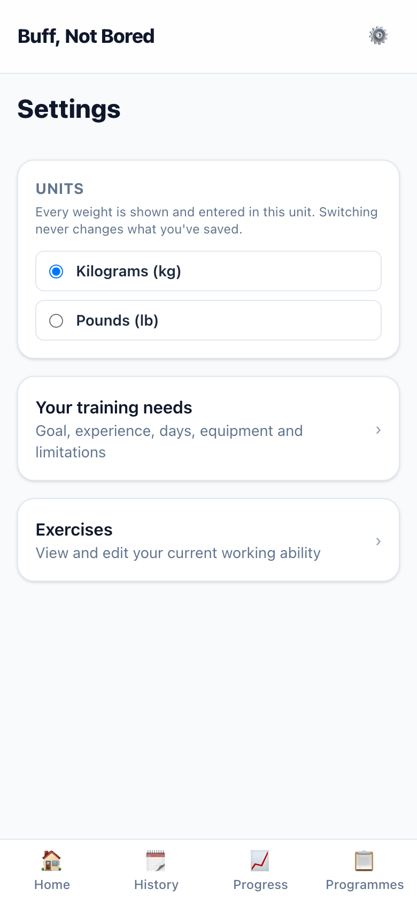
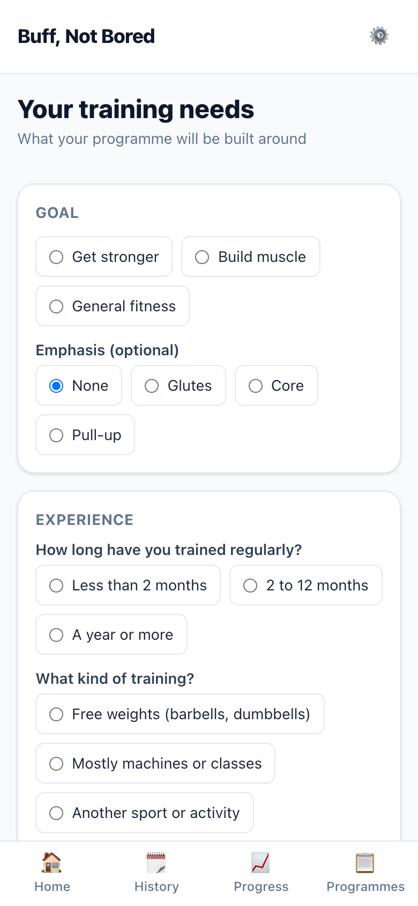
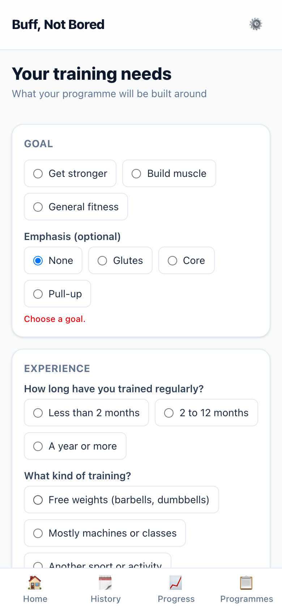
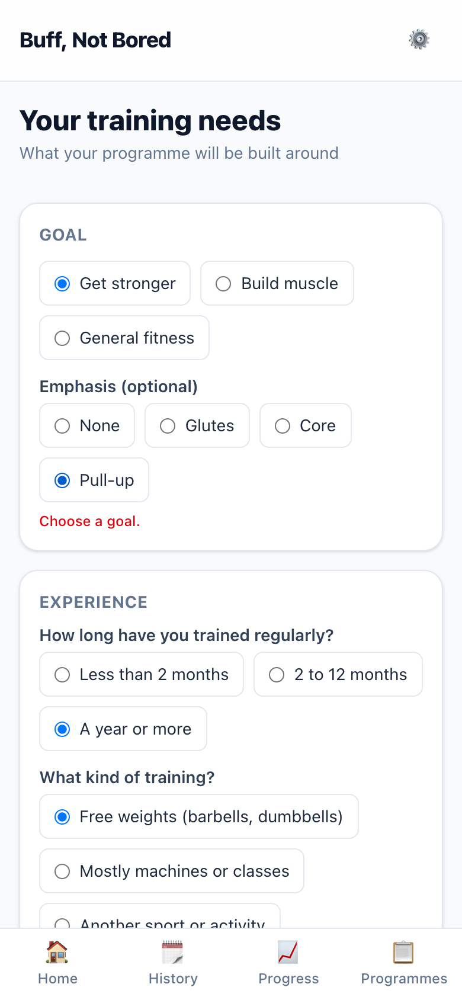
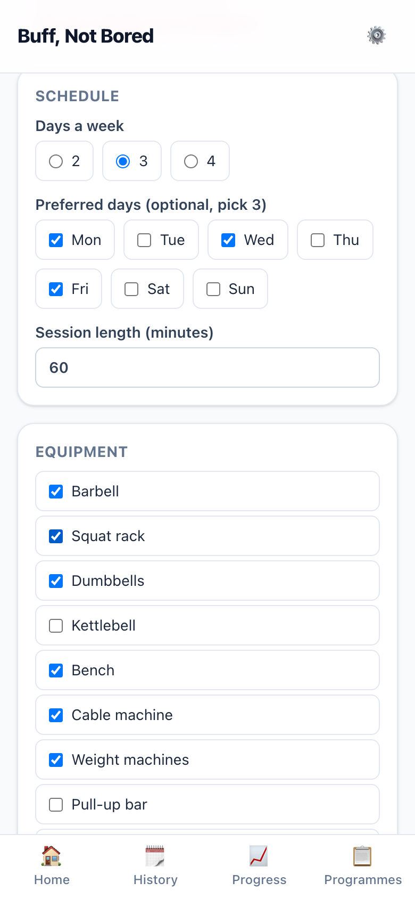
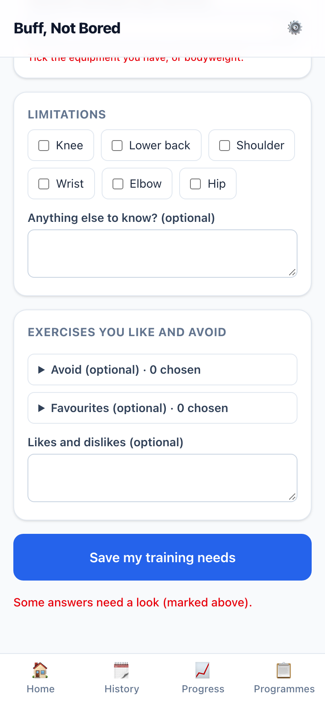
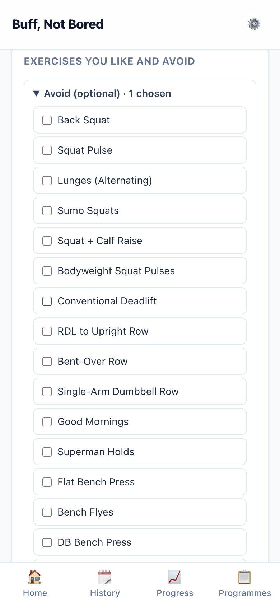
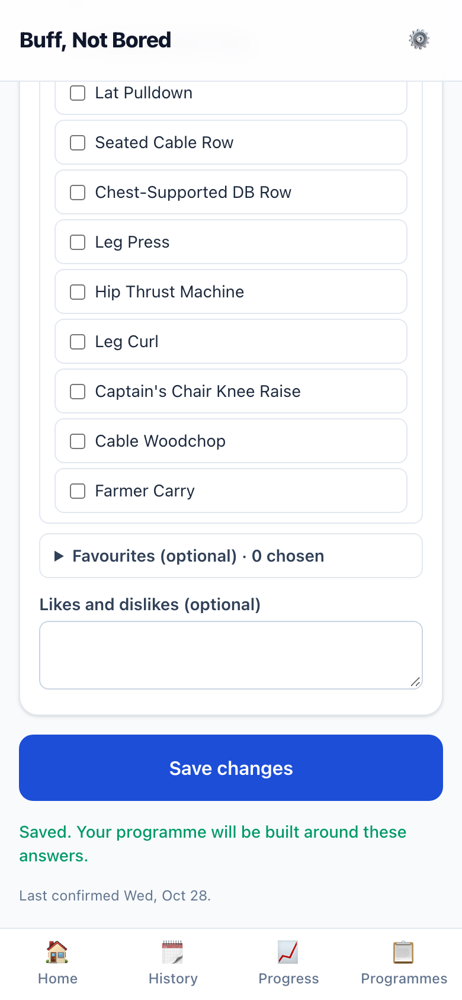
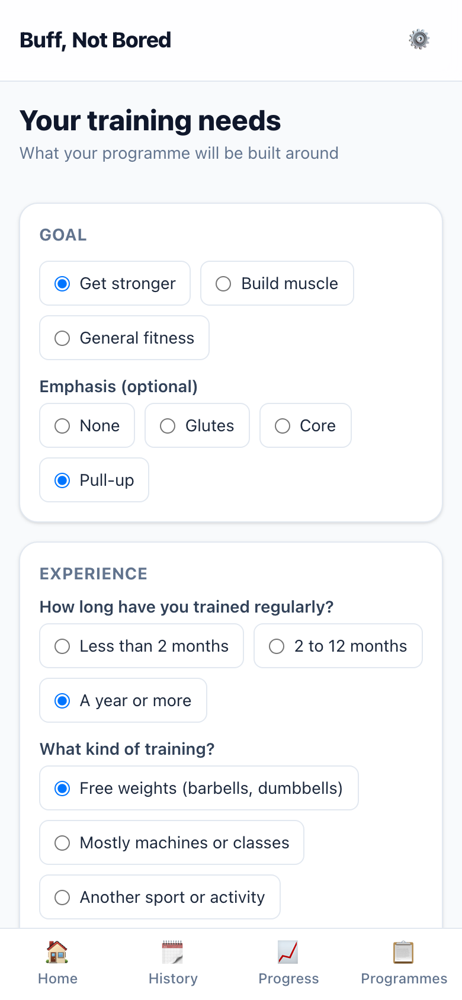

# S-008 · Your training needs (profile)

## What was built
- **"Your training needs"**, reached from ⚙️ Settings. It asks for:
  - **Goal:** get stronger, build muscle or general fitness, plus an optional **emphasis** (glutes, core or pull-up).
  - **Experience:** how long you've trained regularly, what kind of training, and how confident your technique is. Your **experience level** (beginner / intermediate / advanced) is worked out as you answer, and shown.
  - **Schedule:** 2–4 days a week, optional preferred days (pick that many), and session length.
  - **Equipment:** ticked from a list, plus your heaviest dumbbell (in your kg/lb setting) if you have dumbbells.
  - **Limitations:** knee, lower back, shoulder, wrist, elbow or hip, plus a note.
  - **Exercises you like and avoid:** two tick-lists of the library, folded away until you open them, plus a likes-and-dislikes note.
- **Saved and editable.** Saving confirms it, and coming back shows your answers ready to change. Nothing uses it yet; the generator (S-011) will.
- **Problems show next to their answer**, all at once, in plain language. For example: "Pick 3 preferred days to match your days a week, or none."

## Screenshots (390 × 844, in flow order)

| | |
|---|---|
|  | **01 · Settings** now links to Your training needs. |
|  | **02 · First time:** nothing chosen yet. |
|  | **03 · Saving too early:** each problem is shown under its section. |
|  | **04 · Goal and experience answered:** "Your experience level: Advanced". |
|  | **05 · Schedule and equipment.** |
|  | **06 · Limitations and exercises** (lists folded). |
|  | **07 · The avoid list open,** one chosen. |
|  | **08 · Saved**, with when you last confirmed it. |
|  | **09 · Coming back:** your answers, ready to edit. |

## Placeholder UI (design-first)
This is part of onboarding, so it's **proposed, not designed**: one long plain form built from existing pieces. The order, wording and layout are yours to design.

## Things to check
- **How experience is worked out (D-017).** As you approved, it follows training age (under 2 months / 2–12 months / a year or more) and steps down one level if technique confidence is low. **I also step down one level if your training wasn't with free weights**, because the programme is built on free-weight lifts; it never steps down twice. Is that right?
- **"Bodyweight" can be ticked with a pull-up bar or bands.** The spec doesn't say it's exclusive.
- **Free-text notes are kept to 500 characters.** They'll be passed to the AI chat later.

## Data
- **Schema change (approved):** a new one-row `needs_profiles` table. Nothing existing changes. After pulling, run `prisma generate` and `prisma migrate deploy`.

## Questions for you
1. Should training that wasn't with free weights lower the experience level (see "Things to check")? My suggestion: yes.
