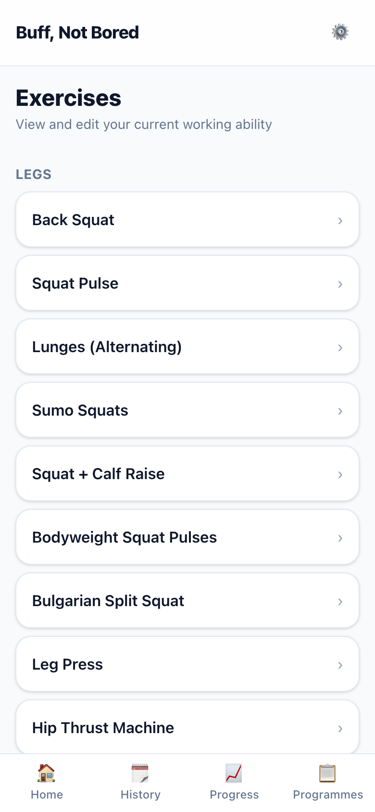
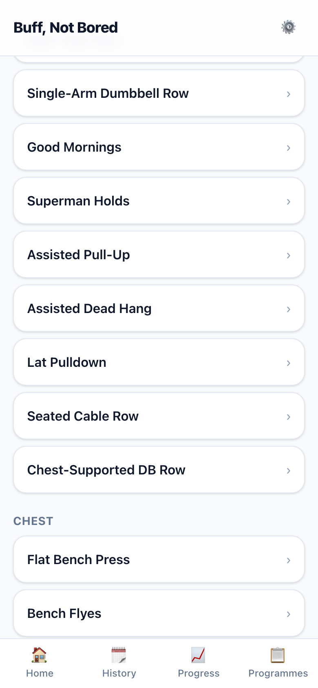
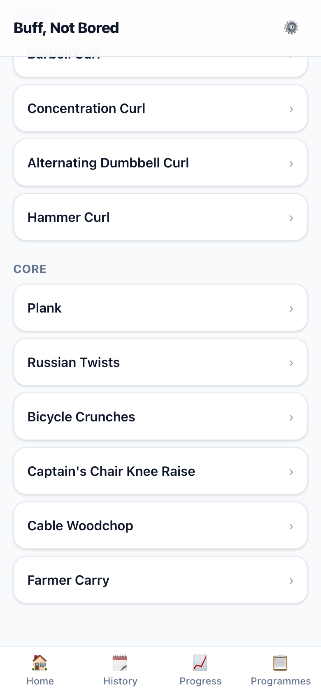
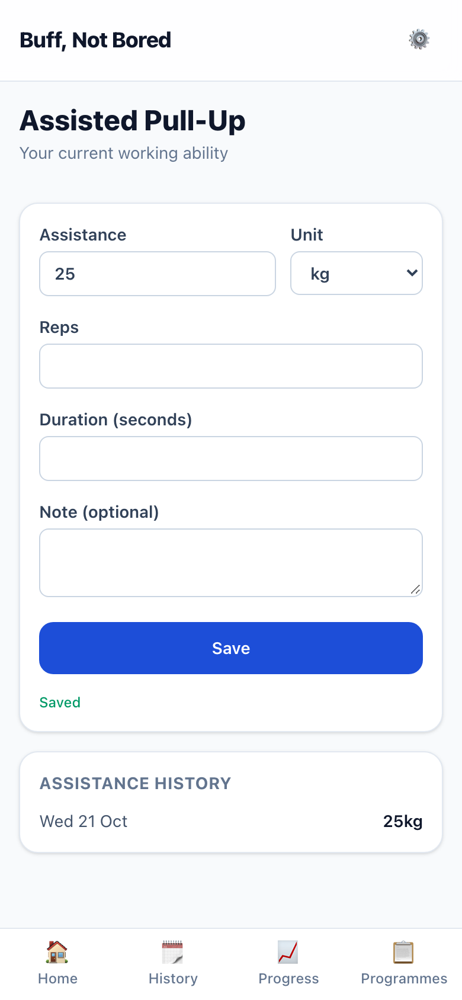
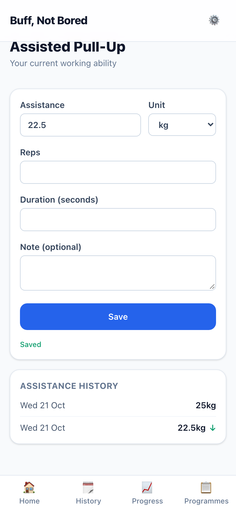
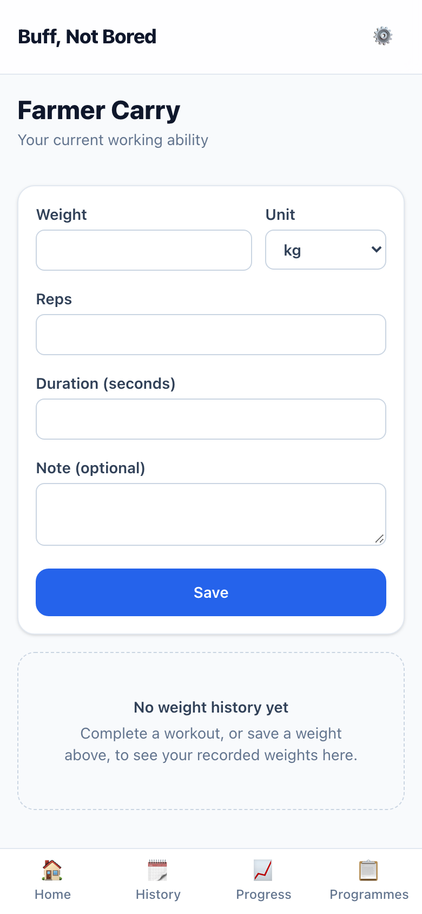
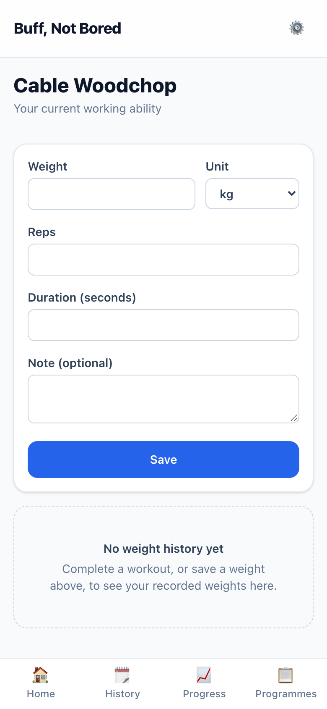
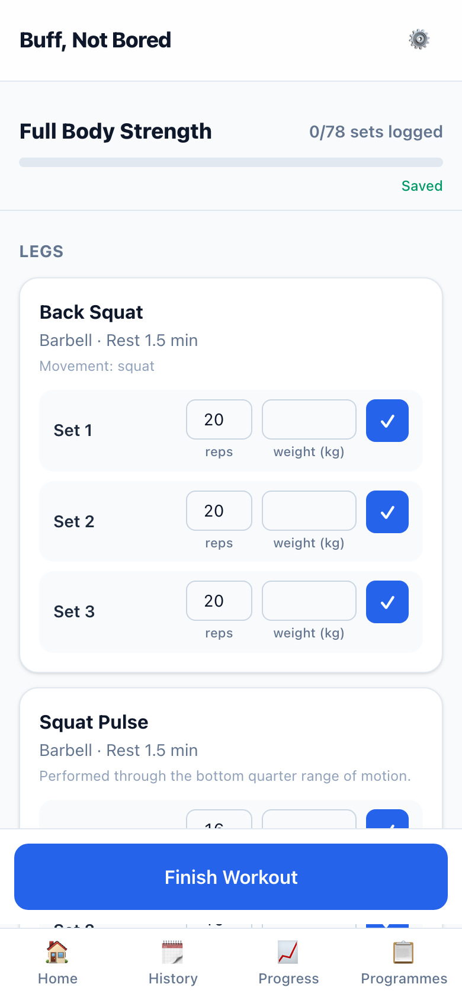

# S-003 · New exercises for Preset Programme 1

## What was built
- **11 new exercises** your Mon/Wed/Fri programme needs: Assisted Pull-Up, Assisted Dead Hang, Lat Pulldown, Seated Cable Row, Chest-Supported DB Row, Leg Press, Hip Thrust Machine, Leg Curl, Captain's Chair Knee Raise, Cable Woodchop and Farmer Carry. Each has muscles (as in your programme), a movement pattern, a station, weight jumps, how it's counted, cues and a swap group.
- **Renamed to match your programme:** Squats → **Back Squat**, Deadlifts → **Conventional Deadlift**, Flat DB Press → **DB Bench Press**. History is kept.
- **Assisted exercises record assistance.** The exercise page says "Assistance", and the history is headed "Assistance History". Going down is progress, so a drop is shown in green.
- **Your workouts don't change yet.** Circuit and the current Strength session still use only the original 33 exercises, swaps and "I'm bored" included. The new exercises appear in your workouts when Preset Programme 1 arrives (S-004).
- **Fixed along the way:** saving a weight on the exercise page of an exercise you'd never done in a workout failed (the database didn't know the exercise yet). It now works, and first-use weights get the same fix.

## Screenshots (390 × 844)

| | |
|---|---|
|  | **01 · Exercises, Legs.** Back Squat renamed; Leg Press, Hip Thrust Machine and Leg Curl added. |
|  | **02 · Exercises, Back.** The pull-up, hang, pulldown and rows. |
|  | **03 · Exercises, Core.** Captain's Chair, Woodchop and Farmer Carry. |
|  | **04 · Assisted Pull-Up, nothing saved yet.** The box says "Assistance". |
|  | **05 · 25 kg assistance saved.** |
|  | **06 · Down to 22.5 kg.** The drop is green, because less assistance is progress. |
|  | **07 · Farmer Carry**, weighted and timed. The page is the same form as every exercise; the weight-and-seconds set row comes with the programme (S-004). |
|  | **08 · Cable Woodchop**, counted per side. Same form; "per side" shows in the workout. |
|  | **09 · Current Strength session**, unchanged apart from the name Back Squat. |

## Check the details
These are my proposed values, as in S-001. Tell me anything to change.

| Exercise | Muscles | Pattern | Class | Load | Station | Counted in |
|---|---|---|---|---|---|---|
| Assisted Pull-Up | lats, upper back, (biceps), (forearms) | vertical pull | compound | assisted machine | machine | reps |
| Assisted Dead Hang | forearms, lats, (upper back) | vertical pull | isolation | assisted machine | machine | seconds |
| Lat Pulldown | lats, (upper back), (biceps) | vertical pull | compound | cable | cable stack | reps |
| Seated Cable Row | upper back, lats, (biceps) | horizontal pull | compound | cable | cable stack | reps |
| Chest-Supported DB Row | upper back, lats, (rear deltoids), (biceps) | horizontal pull | compound | dumbbell pair | bench | reps |
| Leg Press | quads, glutes | squat | compound | machine | machine | reps |
| Hip Thrust Machine | glutes, (hamstrings) | hip extension | compound | machine | machine | reps |
| Leg Curl | hamstrings | hinge | isolation | machine | machine | reps |
| Captain's Chair Knee Raise | abdominals, (hip flexors) | anti extension | isolation | bodyweight | machine | reps |
| Cable Woodchop | obliques, (abdominals) | rotation | isolation | cable | cable stack | reps per side |
| Farmer Carry | forearms, obliques, (abdominals) | carry | compound | dumbbell pair | open space | seconds |

| Exercise | Jumps | Lower is progress? | Progression | Light alternative | Swap group | Joint stress |
|---|---|---|---|---|---|---|
| Assisted Pull-Up | +0.25 / +0.5 / +1 / +2.5 / +5 kg | yes (assistance) | ladder | – | assisted-vertical-pull | shoulder, elbow |
| Assisted Dead Hang | +0.25 / +0.5 / +1 / +2.5 / +5 kg | yes (assistance) | ladder | – | dead-hang | shoulder |
| Lat Pulldown | +0.25 / +0.5 / +1 / +2.5 / +5 kg | – | load nudge | – | vertical-pull | shoulder |
| Seated Cable Row | +0.25 / +0.5 / +1 / +2.5 / +5 kg | – | load nudge | Chest-Supported DB Row | horizontal-pull | lower back |
| Chest-Supported DB Row | +0.25 / +0.5 / +1 / +2 / +2.5 kg | – | load nudge | – | horizontal-pull | – |
| Leg Press | +0.25 / +0.5 / +1 / +2.5 / +5 kg | – | load nudge | Bodyweight Squat Pulses | squat | knee, hip |
| Hip Thrust Machine | +0.25 / +0.5 / +1 / +2.5 / +5 kg | – | load nudge | – | hip-extension | hip |
| Leg Curl | +0.25 / +0.5 / +1 / +2.5 / +5 kg | – | double progression | – | leg-curl | knee |
| Captain's Chair Knee Raise | – | – | ladder | Plank | anti-extension | lower back |
| Cable Woodchop | +0.25 / +0.5 / +1 / +2.5 / +5 kg | – | double progression | Bicycle Crunches | rotation | lower back |
| Farmer Carry | +0.25 / +0.5 / +1 / +2 / +2.5 kg | – | load nudge | – | carry | – |

**Cues**
- **Assisted Pull-Up.** Kneel on the pad and take an overhand grip just wider than your shoulders. Pull your elbows down towards your ribs. Lower all the way to straight arms.
- **Assisted Dead Hang.** Kneel on the pad and hold the bar with an overhand grip. Hang with long arms and relaxed shoulders. Grip hard and breathe steadily.
- **Lat Pulldown.** Thighs under the pad, hands just wider than your shoulders. Pull the bar to your upper chest. Let it rise with control to straight arms.
- **Seated Cable Row.** Sit tall with feet on the plates and knees soft. Pull the handle to your stomach, squeezing your shoulder blades. Don't rock back to move the weight.
- **Chest-Supported DB Row.** Lie chest-down on an incline bench, a dumbbell in each hand. Row your elbows back past your ribs. Keep your chest on the pad.
- **Leg Press.** Back flat on the pad, feet shoulder-width in the middle of the platform. Lower until your knees are near your chest. Press through your whole foot; don't lock your knees.
- **Hip Thrust Machine.** Upper back on the pad, belt across your hips, feet flat. Drive through your heels until your hips are level. Squeeze your glutes at the top; keep your ribs down.
- **Leg Curl.** Line your knees up with the machine's pivot, pad just above your heels. Curl your heels towards your glutes. Lower slowly; don't let the stack slam.
- **Captain's Chair Knee Raise.** Forearms on the pads, back against the backrest, legs hanging. Curl your knees up by tilting your pelvis. Lower slowly without swinging.
- **Cable Woodchop.** Stand side-on to the cable, handle high, feet wider than your hips. Pull across and down, turning from your ribs. Pivot your back foot; keep your arms long.
- **Farmer Carry.** Stand tall between two dumbbells, then pick them up like a deadlift. Walk with short, steady steps. Shoulders down, ribs stacked over hips.

## Decisions to check
- **Light alternatives (as agreed):** the assisted exercises have none, because their lighter version is more assistance. Captain's Chair → Plank, Woodchop → Bicycle Crunches, Seated Cable Row → Chest-Supported DB Row, Leg Press → Bodyweight Squat Pulses. Lat Pulldown, Chest-Supported Row, Hip Thrust, Leg Curl and Farmer Carry have none yet: the library has nothing lighter in the same pattern until the Phase 1 library expansion.
- **Assisted exercises aren't paired with loaded ones** (for example, the pull-up isn't swappable for the pulldown). Assistance and weight move in opposite directions, so a swap between them would carry a meaningless number. The app now refuses such pairings.
- **Machine and cable jumps** use the barbell jumps, starting at 0.25 kg (D-007), for add-on plates.
- **Pull-up and dead hang progress on the ladder** (§6.5, §10.3). Preset 1 itself uses double progression, set by the programme in S-004.

## Proposed spec change
- §9.1 lists no **knee-flexion** pattern, so Leg Curl is filed under **hinge** (the closest hamstring pattern). I suggest adding "knee flexion" to the §9.1 list.

## Placeholder UI
Nothing new here is design-first. The exercise page is the existing form, with "Assistance" swapped in where it applies.

## Questions for you
None, unless something in the tables above looks wrong.
