# S-004 · Preset Programme 1 replaces today's Strength session

## What was built
- **Strength is now your programme.** The 26-exercise "Full Body Strength" session is gone. Strength shows Monday, Wednesday or Friday from Preset Programme 1, exactly as in the spec (§10.1): 7, 7 and 8 exercises.
- **The session due next comes up first.** The rotation runs Monday → Wednesday → Friday → Monday, whatever today's date is, with no rest-day note. It moves on once you've logged at least one set, even if you don't tap Finish. The **Mon / Wed / Fri** buttons let you pick any session instead.
- **Each exercise shows sets × range** ("3 × 8–12", "3 × 20–30 s", "2 × 10 per side"). The reps box starts at the bottom of the range.
- **Rest is a recommendation only:** "Recommended rest 2–3 min" for compound lifts, "60–90 s" for isolation work. There's no timer and nothing stops you.
- **Supersets** (Seated Cable Row + Lateral Raises on Monday, Chest-Supported Row + Lateral Raises on Friday) sit together in one box, with one rest line "after both" (the longer of the two).
- **Set rows:** reps or seconds first, then weight. Every weight starts blank and is asked for at first use. The labels change to suit the exercise:
  - **assistance (kg)** on the assisted pull-up and dead hang;
  - **weight each (kg)** for dumbbell pairs;
  - **reps / side** on the woodchop.

  Timed exercises that take a load (Farmer Carry, the dead hang) get both a seconds box and a weight box.
- **Reps before weight everywhere (D-009):** Circuit's reps control now comes before weight, its summary line reads "20 reps · 35kg · Barbell", and logged sets read "20 reps × 35kg". The same goes for Strength.
- **Form cues:** Strength cards show the exercise's first form cue (for example "Brace before you descend.") instead of "Movement: squat".
- **Unchanged, as you asked:** Home and Programmes still show the old "8 Week Strength" schedule until you design Home (D-013). Circuit's exercises are also unchanged.

## Screenshots (390 × 844, in flow order)

**Choosing a session**

| | |
|---|---|
|  | **01 · Strength opens on the session due:** Monday, with its exercises and the Mon / Wed / Fri picker. |
| 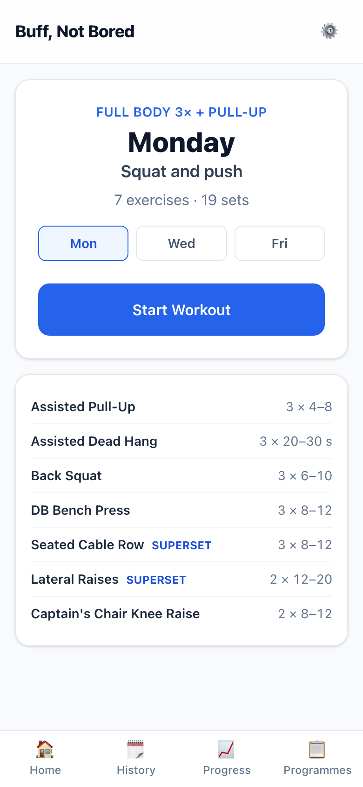 | **02 · The exercise list**, with superset pairs marked. |
| 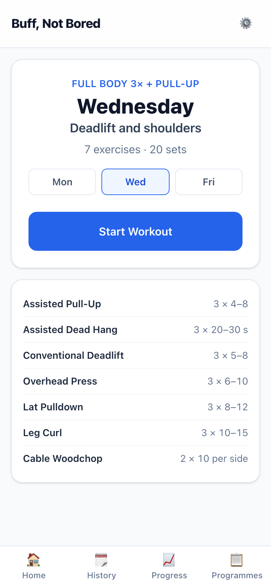 | **03 · Picking Wednesday.** |
| 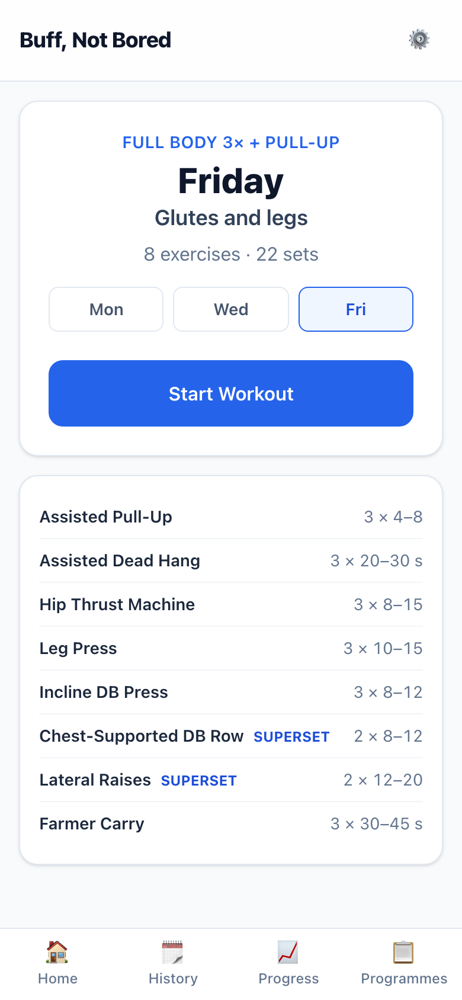 | **04 · Picking Friday.** |

**In the workout (Monday)**

| | |
|---|---|
| 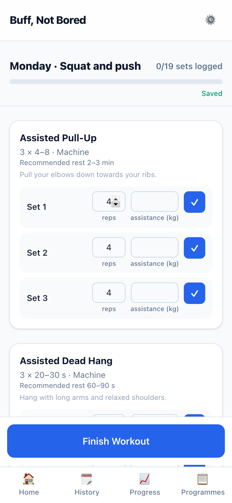 | **05 · Pull-up work first.** Assistance is blank, with the reps box at the bottom of the range (4). |
| 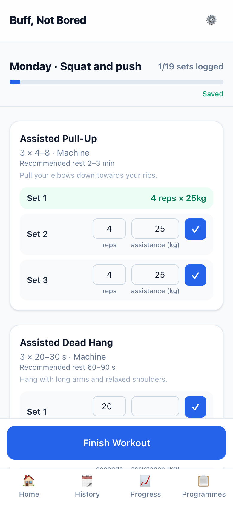 | **06 · First set logged at 25 kg assistance.** Sets 2 and 3 fill in, and "4 reps × 25kg" reads reps first. |
| 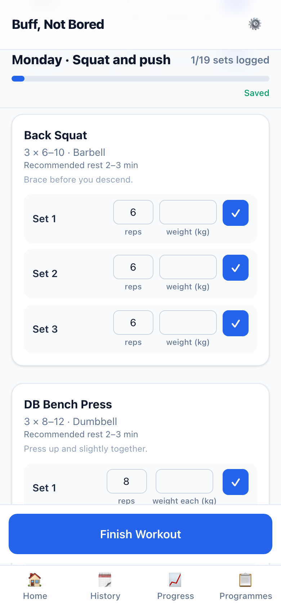 | **07 · Back Squat:** 3 × 6–10, recommended rest, form cue. |
| 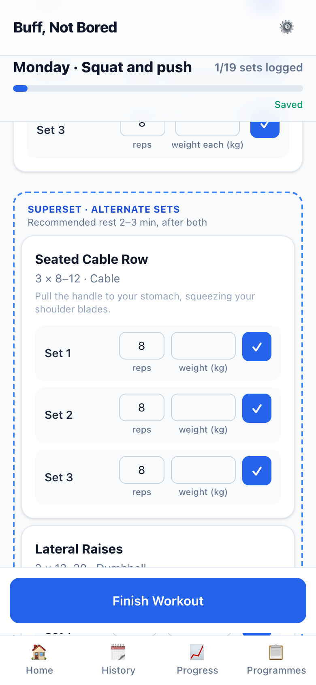 | **08 · The superset pair** in one box, with a shared rest line. |

**The rotation**

| | |
|---|---|
|  | **09 · After logging a set on Monday**, reopening Strength offers Wednesday. |

**Other days**

| | |
|---|---|
| 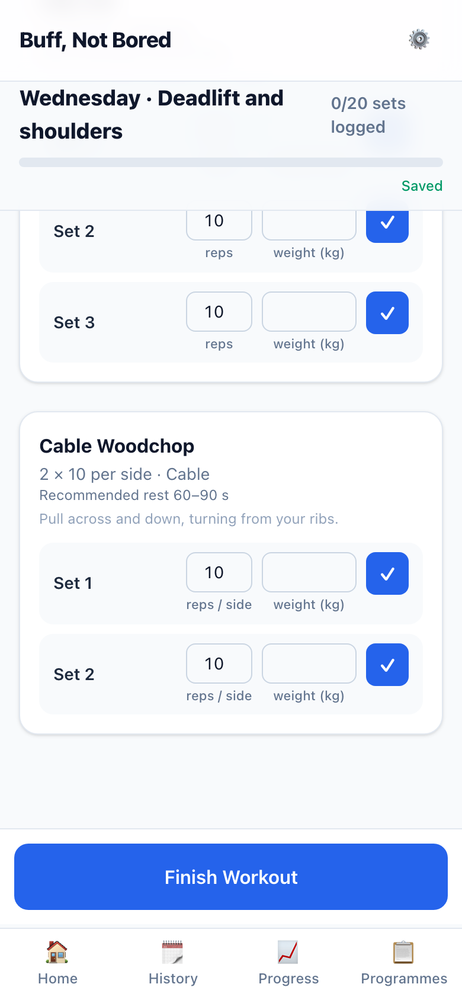 | **10 · Wednesday, Cable Woodchop:** "2 × 10 per side", with the box labelled "reps / side". |
| 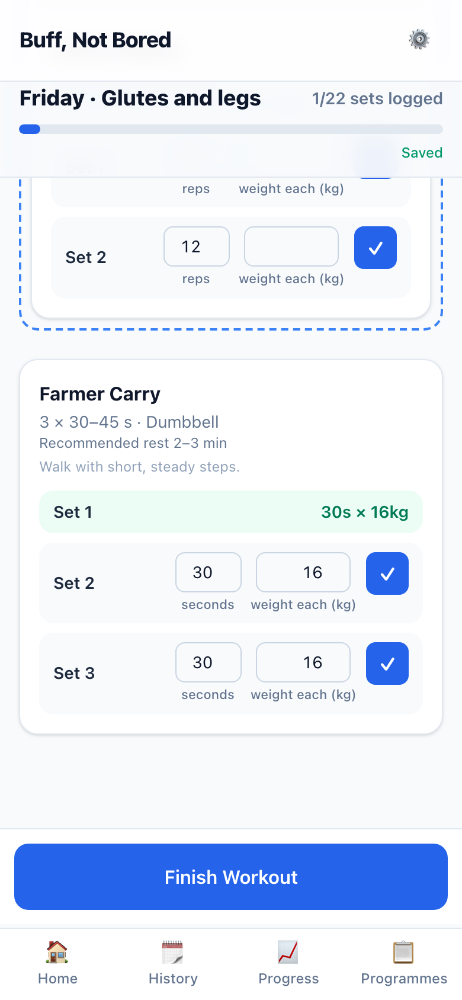 | **11 · Friday, Farmer Carry:** seconds and weight each, logged as "30s × 16kg". |

**Circuit**

| | |
|---|---|
| 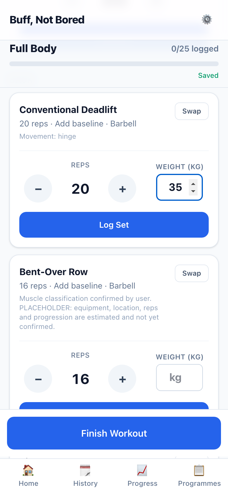 | **12 · Reps before weight** on Circuit (first-use weight box shown). |
| 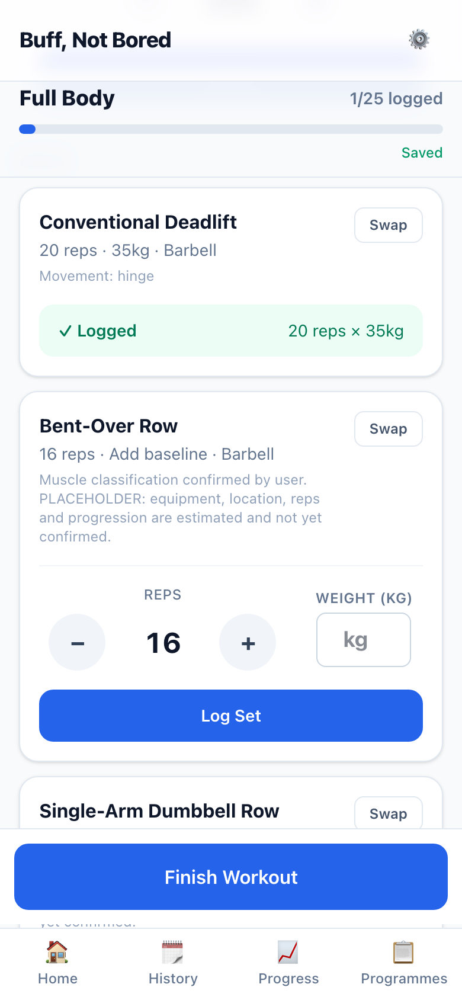 | **13 · Logged:** "20 reps × 35kg". |

## How to try it yourself
1. Run `pnpm --filter @buff-not-bored/web dev` and open http://localhost:3000/strength.
2. You'll start on Monday. Log a set, then reopen Strength: Wednesday is next.

## Placeholder UI (design-first)
Set logging is design-first, so everything below is **proposed, not designed**: a working skeleton built from the existing components.
- the session picker (Mon / Wed / Fri buttons);
- the exercise list on the overview;
- the dashed superset box;
- the set rows and their labels.

## Deviations and things to know
- **The workout summary's "progression recommendations"** still come from the old engine until S-005 brings the nudge. I made one fix now: inside a rep range they judge against the **top** of the range, so 9 reps of 8–12 says "Maintain", not "add weight".
- **Saved workouts record which session they were**, for the rotation. Saved sets keep the bottom of the range as their target; the full range lives in the programme (noted in the backlog).
- **Heads-up:** running the tests (`pnpm test`) empties your local database. This isn't new; I've added it to the backlog to fix. Your review screenshots come from a separate database.

## Questions for you
None.
