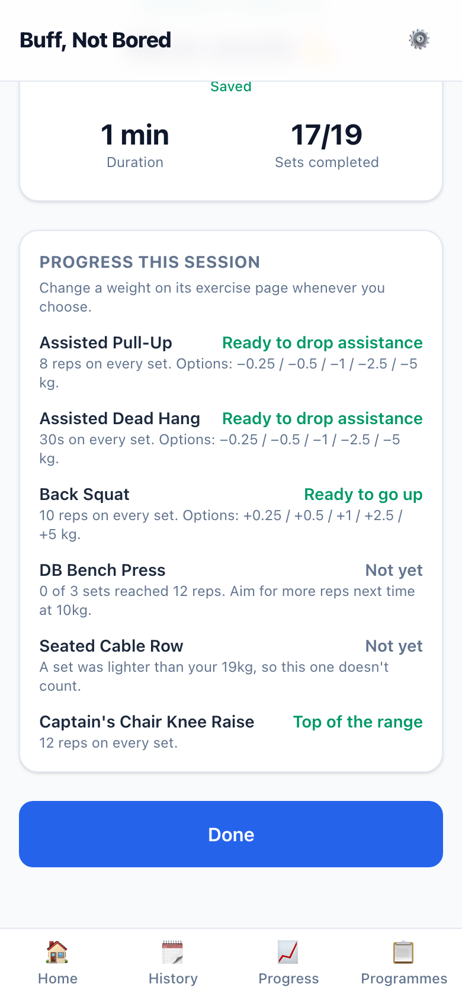
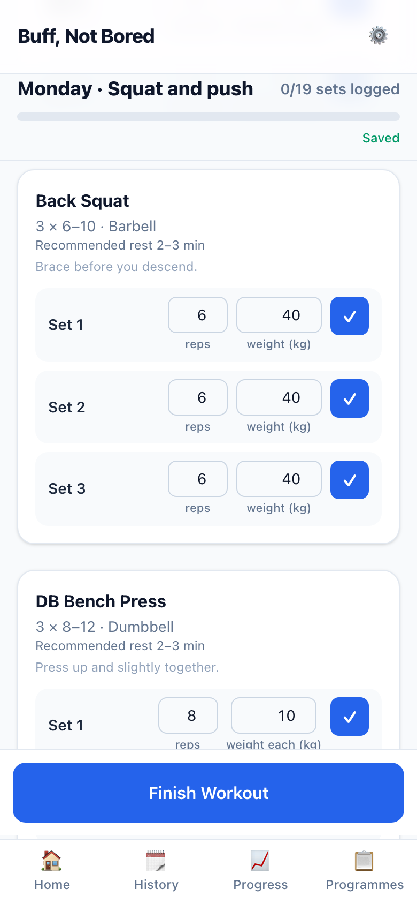

# S-005 · Progression becomes a nudge

## What was built
- **The Strength summary no longer suggests weights.** The old "20kg → 21kg · Recommended progression" lines are gone. In their place, **Progress this session** gives each exercise you logged a plain-text notification:
  - **Ready to go up:** every set reached the top of the range at your current weight or more. It lists the exercise's real jumps, for example "+0.25 / +0.5 / +1 / +2.5 / +5 kg".
  - **Ready to drop assistance:** the same for the assisted pull-up and dead hang, with "−" options, and never more than the assistance you have.
  - **Top of the range:** a bodyweight exercise, which has no weight to add.
  - **Not yet:** with the reason. Either "2 of 3 sets reached 12 reps. Aim for more reps next time at 10kg" (or "longer holds" for timed exercises), or a set was lighter than your current weight, or a set was logged without one.
- **It's a notification only (D-014).** Nothing changes your weight. Each exercise name links to its page, where you change the weight yourself if you choose.
- **Judged on one session.** Reaching the top of the range on every set in one workout is enough (§10.1). The trigger uses reps (or seconds) only until set feedback arrives in Phase 1 (D-006).
- **Unchanged:** Circuit keeps its percentage progression (§3.3), now in 0.25 kg steps (D-007). The Progress screen is also unchanged; it only shows Circuit for now.

## Screenshots (390 × 844, in flow order)

| | |
|---|---|
|  | **01 · Workout complete.** The summary as before, from a Monday where six exercises were logged. |
|  | **02 · Progress this session**, one notification per exercise: drop assistance (pull-up; dead hang, timed), go up (Back Squat), not yet with more reps (DB Bench Press), not yet after a lighter set (Seated Cable Row), and top of the range (Captain's Chair, bodyweight). |
|  | **03 · Next Monday.** Back Squat still prescribes 40 kg: being "ready" changed nothing by itself. |

## Placeholder UI (design-first)
The progression nudge is design-first. This list is **proposed, not designed**: plain text, no buttons. The real nudge comes in Phase 1, at the start of a session, with chips to tap and "Not yet".

## Deviations and things to know
- **Circuit's percentage suggestions now land on 0.25 kg steps** (for example 8 kg → 8.25 kg), per D-007. Circuit's +/− buttons still move in 2.5 / 0.5 kg taps, so they can't always reach the suggested number. Logged in the backlog for the set-logging design.
- **On a first-use day**, readiness is judged against the weight you set during that session.

## Questions for you
None.
