# S-015 · Getting to know you: the setup conversation

## What was built
- **Home opens with a conversation until your training needs are saved.** One question at a time, with a progress line ("Question 3 of 13") and **Back**.
  - Tap an answer to move on. Multi-choice questions (equipment, limitations) have **Done**.
  - Every optional question has **Skip**.
  - Questions only appear when they apply. "What's your heaviest dumbbell?" only comes up if you ticked dumbbells, so the count goes from 13 to 14. "Anything else I should know?" only comes up if you ticked a limitation.
  - After the experience questions the app says what it's worked out: "Thanks! Sounds like you're advanced."
  - **Exercises to avoid and favour:** it asks "Any?" first, and only then shows a search (progressive disclosure).
- **A summary to finish.** Every answer has **Change**, which comes straight back to the summary. Then **Save**: "Saved. Your programme comes next." That links to the generator once it exists.
- **"Not now" keeps your place** (saved in the database, so it works on any device). Home then shows **"Finish setting up your training. You stopped at question N of M · Carry on"**, which resumes exactly where you were.
- **Once you're set up, Home looks as before.** Returning users get the check-in in S-016. Your answers stay editable in ⚙️ Settings → Your training needs.

## Screenshots (390 × 844, in flow order)

| | |
|---|---|
| 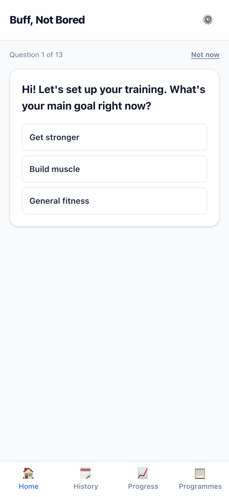 | **01 · Home, first time:** question 1 of 13. |
| 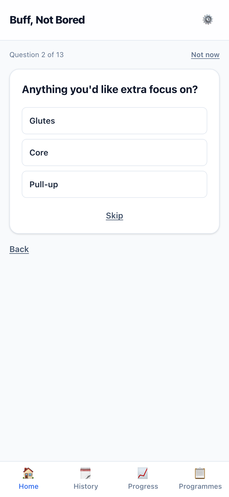 | **02 · An optional question** with Skip. |
| 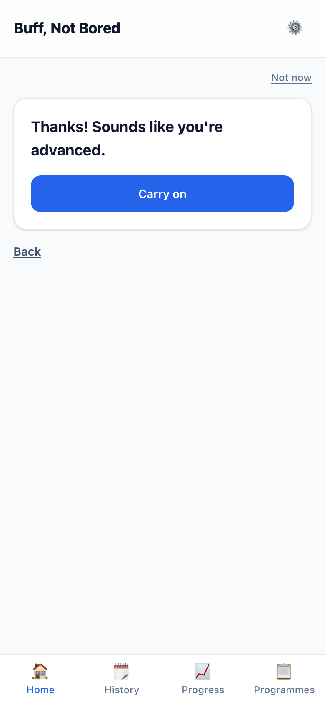 | **03 · Your experience level**, worked out. |
| 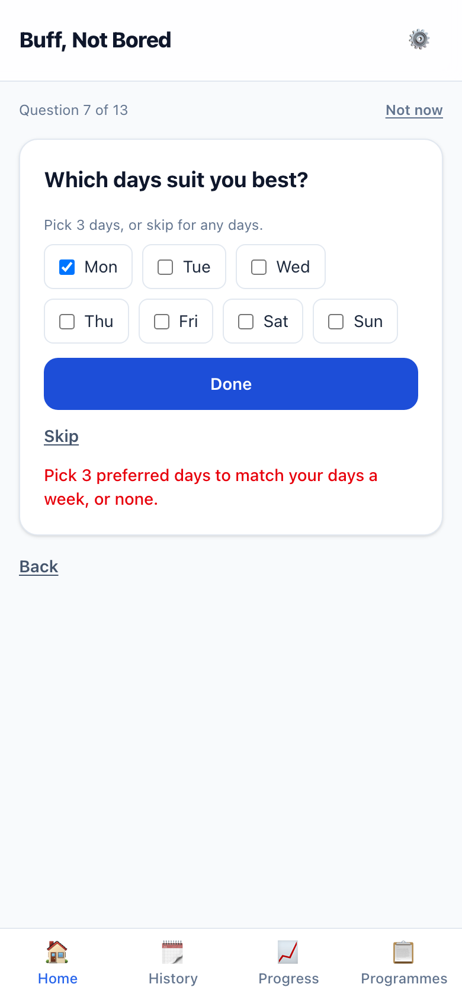 | **04 · A problem explained** (1 preferred day picked for 3 a week). |
| 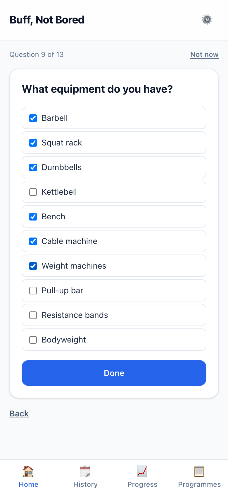 | **05 · Multi-choice:** equipment, then Done. |
| 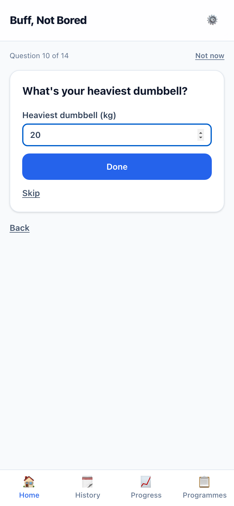 | **06 · Only because you have dumbbells:** heaviest dumbbell (in your kg/lb). |
| 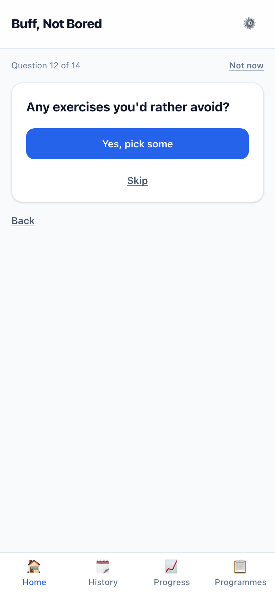 | **07 · Avoid exercises:** "Yes, pick some" or Skip. |
| 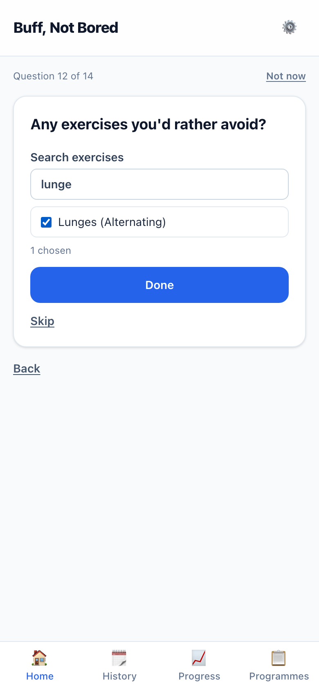 | **08 · Then a search** to find and tick. |
| 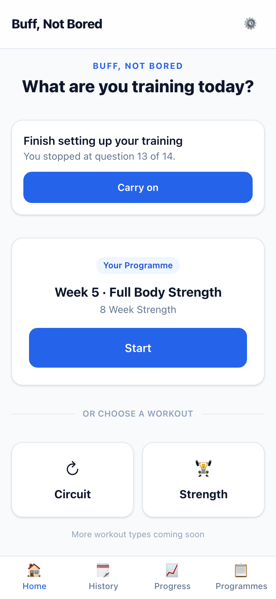 | **09 · "Not now":** Home offers "Carry on". |
|  | **10 · Carry on:** straight back to where you were. |
| 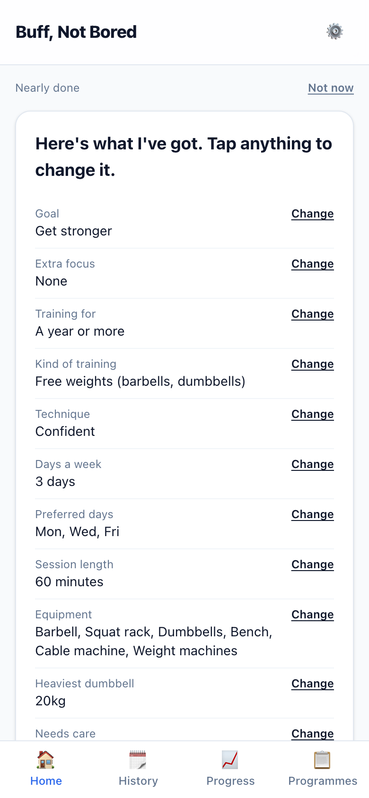 | **11 · The summary,** each answer with Change. |
| 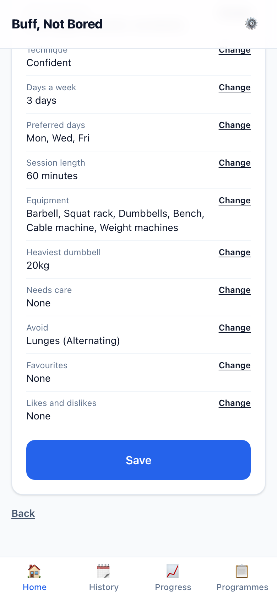 | **12 · The end of the summary** and Save. |
| 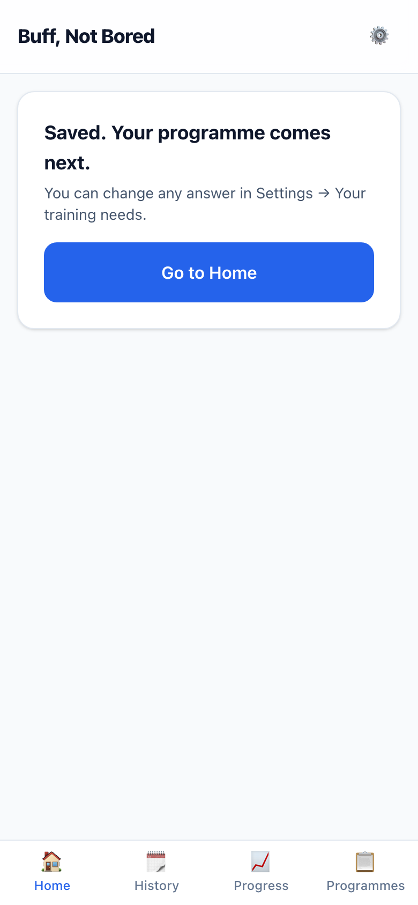 | **13 · Saved. Your programme comes next.** |
| 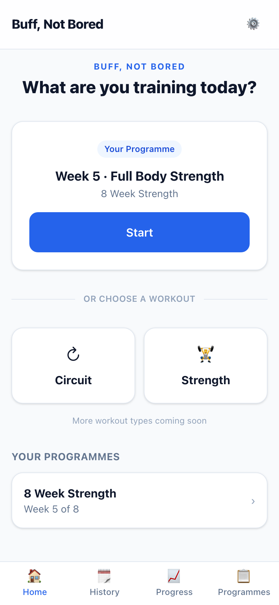 | **14 · Home once you're set up.** |

## Placeholder UI (design-first)
Home and onboarding are design-first, so this is **proposed, not designed**: plain cards and buttons, and the wording in `apps/web/lib/needs-conversation-copy.ts` is mine, for you to rewrite. The order of questions, the Skip rules and the checks are the engine's, and are tested.

## Things to know
- **The rest of Home is unchanged,** including the old "8 Week Strength" card (D-013), until your Home design.
- **The question count changes with your answers** (13 → 14 if you have dumbbells).

## Data
- **Schema change (approved):** a one-row `needs_conversation_drafts` table for a conversation in progress. Saving your training needs removes it. After pulling, run `prisma generate` and `prisma migrate deploy`.

## Questions for you
None.
