# S-002 · Your weights move out of the library

## What was built
- **The library no longer holds any weights.** The old seed numbers (Squats 20 kg and so on) are gone, including the "working range" notes.
- **Your weights come from you.** Strength and Circuit sessions prescribe the weight saved on each exercise's page ("Your current working ability").
- **First use:** a weighted exercise with no weight yet shows an empty weight box. The first weight you log becomes your starting point. It's saved to the exercise page and its weight history, and on Strength it fills in the rest of that exercise's sets straight away.
- **After that, the app never changes your weight by itself (§3.3).** Lifting more or less on the day is recorded for that session only. Your weight changes only when you edit it on the exercise page (and, later, by accepting a progression nudge).
- **Bodyweight exercises** (plank, push-ups and so on) are recognised by their load type, so they still say "Bodyweight" rather than asking for a weight.

## Screenshots (390 × 844, in flow order)

**Strength, first use**

| | |
|---|---|
| 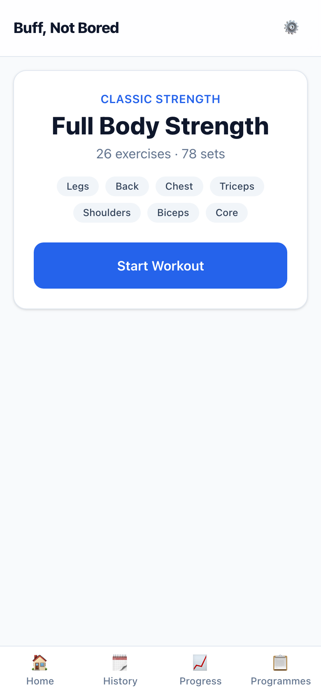 | **01 · Overview.** Unchanged. |
| 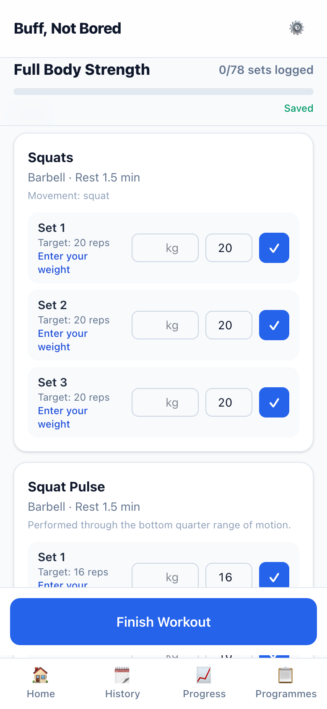 | **02 · No weight yet.** Each set says "Enter your weight", with an empty kg box. |
| 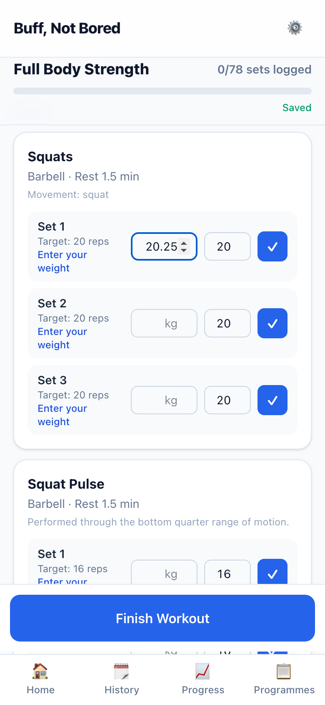 | **03 · Typing the first weight**, 20.25 kg. |
| 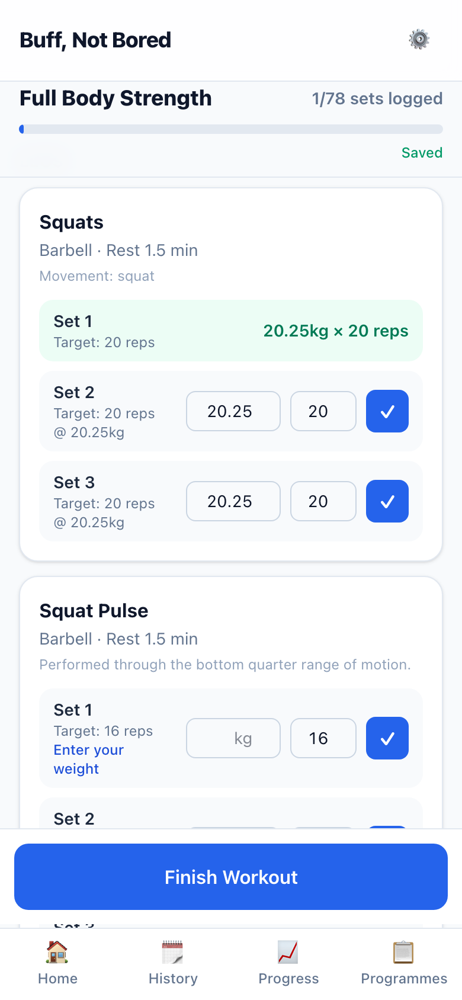 | **04 · First set logged.** Sets 2 and 3 now target 20.25 kg. |
| 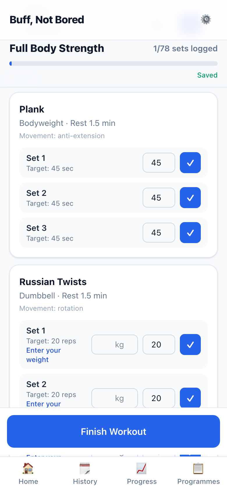 | **05 · Bodyweight exercise** (Plank): no weight box. A loaded exercise below (Russian Twists) still asks. |

**Exercise page**

| | |
|---|---|
| 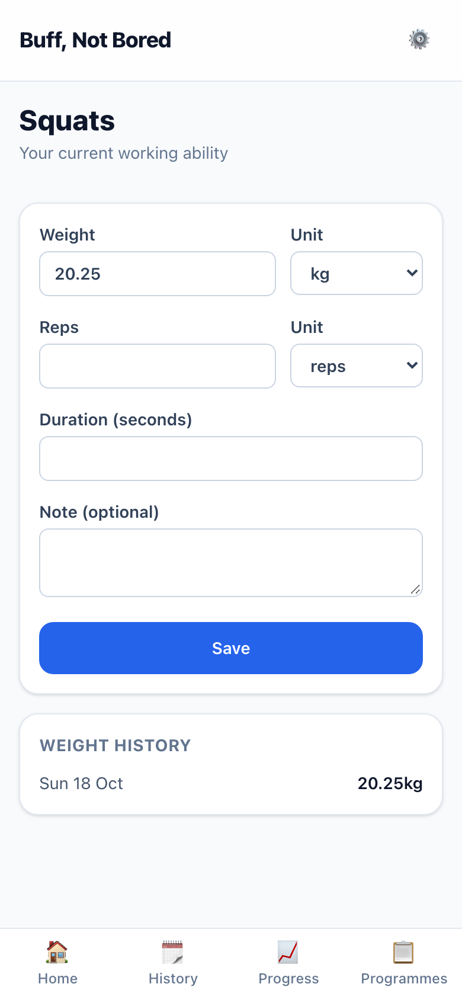 | **06 · After first use.** Squats shows 20.25 kg and one history entry. |
| 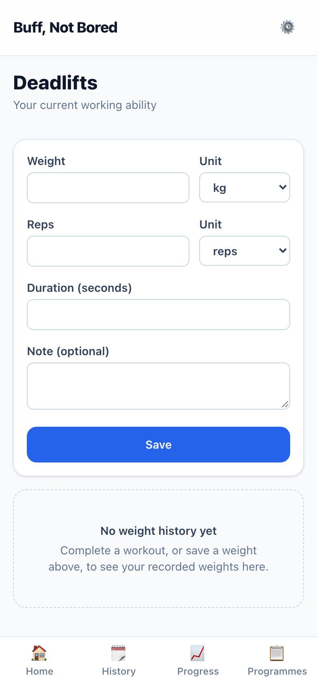 | **07 · No weight yet** (Deadlifts): empty, as before. |

**Strength, next session**

| | |
|---|---|
| 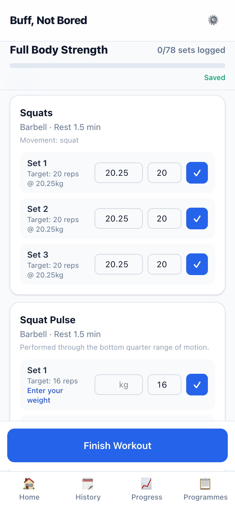 | **08 · Next session.** Squats is prescribed your 20.25 kg; Squat Pulse still asks. |

**Circuit**

| | |
|---|---|
| 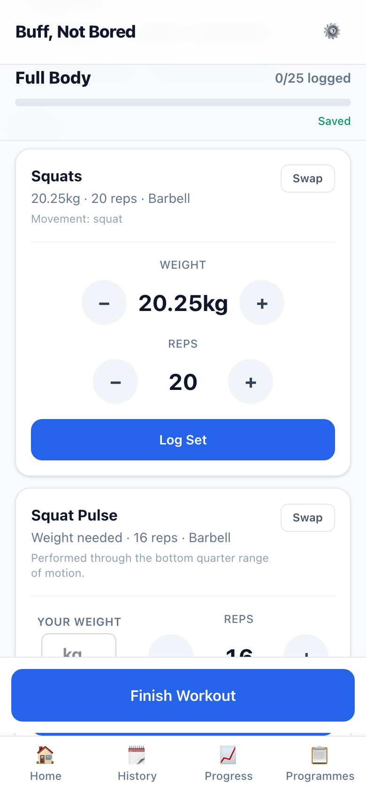 | **09 · Your weight and weight needed.** Squats uses your 20.25 kg with the +/− buttons; Squat Pulse says "Weight needed" and shows a typed "Your weight" box. |
| 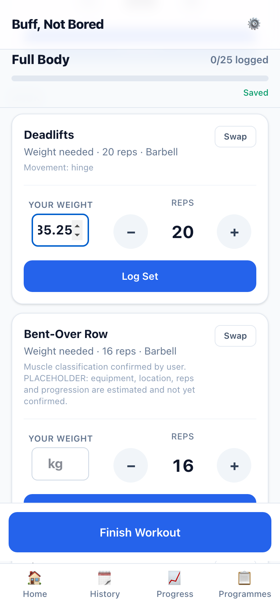 | **10 · Typing a first weight** on Deadlifts, 35.25 kg. |
| 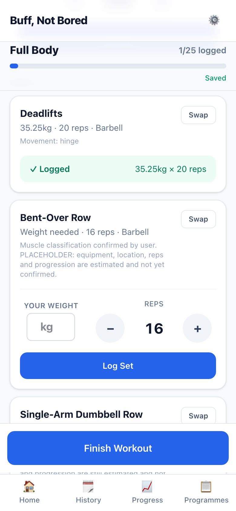 | **11 · Logged.** Deadlifts now shows your 35.25 kg straight away. |
| 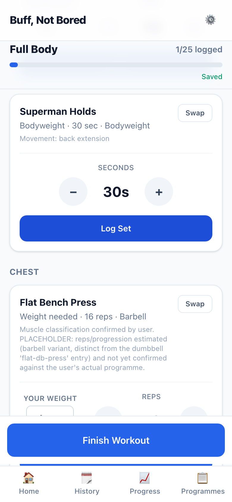 | **12 · Bodyweight exercise** on Circuit. |

## How to try it yourself
1. Run `pnpm --filter @buff-not-bored/web dev` and open http://localhost:3000/strength on your phone-sized window.
2. Tap **Start Workout**. Squats will ask for your weight: type one into set 1 and tap ✓.
3. Open **/exercises/squats** to see it saved, then start a new Strength session to see it prescribed.

Your local database is empty right now, so every weight will start blank, as you asked (D-003). The screenshots came from a separate review database, so your data wasn't touched.

## Placeholder UI (design-first)
The empty weight box and its "Enter your weight" / "Your weight" labels are a **working skeleton only**. Entering a weight is part of set logging, which is design-first, so this stops here for your design.

## Deviations and things to know
- **Fixed along the way, because 0.25 kg weights exposed them:**
  - On Circuit, a wide weight like "20.25kg" pushed the reps control off the screen. Weight and reps now stack when there isn't room (shot 09).
  - The Circuit +/− buttons rounded 20.25 + 2.5 to 22.8. They now give 22.75.
  - The Strength weight box was too narrow for "20.25".
  - Strength targets were rounded to the nearest 0.5 kg. They now keep 0.25 kg steps (D-007).
- **Your session is kept.** Coming back to Strength or Circuit re-applies your weights to the session you already have, so a swap or "I'm bored" refresh you accepted before starting isn't lost. A workout in progress only ever has blank weights filled in.
- **Safeguards:** a zero or negative weight is never logged. Two first-use saves for the same exercise at once can't both win. If a starting weight fails to save, the workout screen says so, and you're asked again next session.
- **Assisted exercises:** the logic is ready, but there's nothing to show until the pull-up arrives in Phase 1.

## Questions for you
1. Wording: "Enter your weight" (Strength) and "Your weight" (Circuit) are placeholders. Any preference before the design pass?
