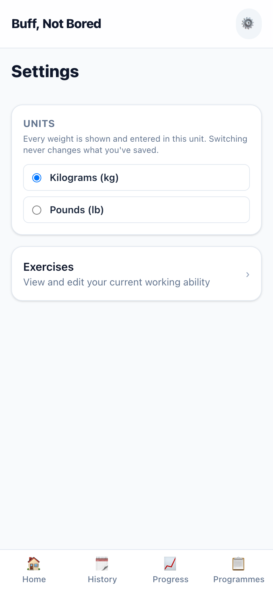
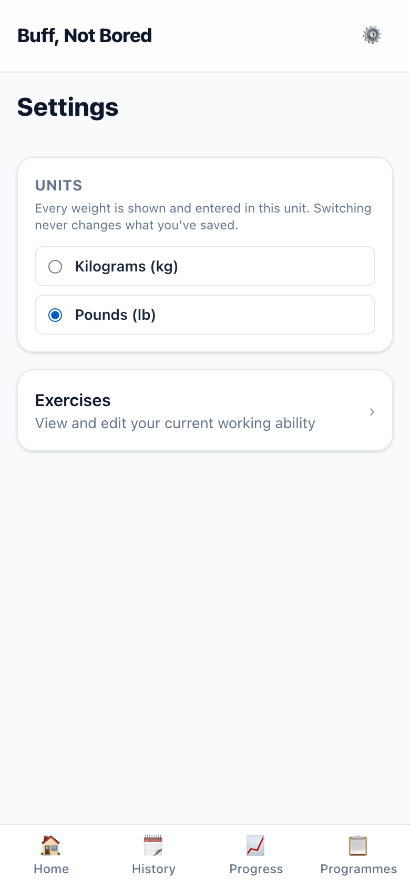
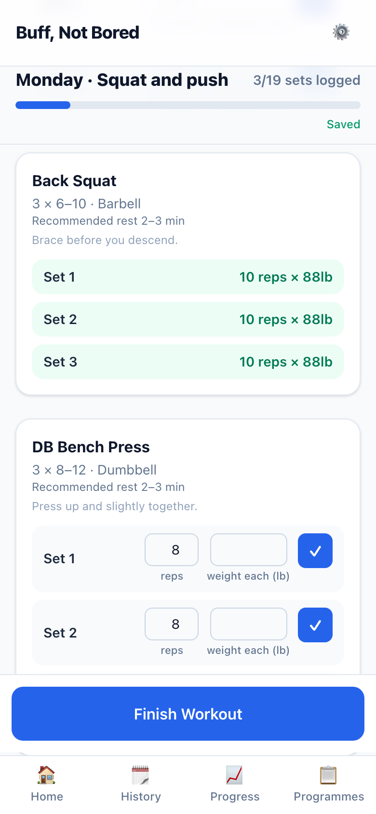
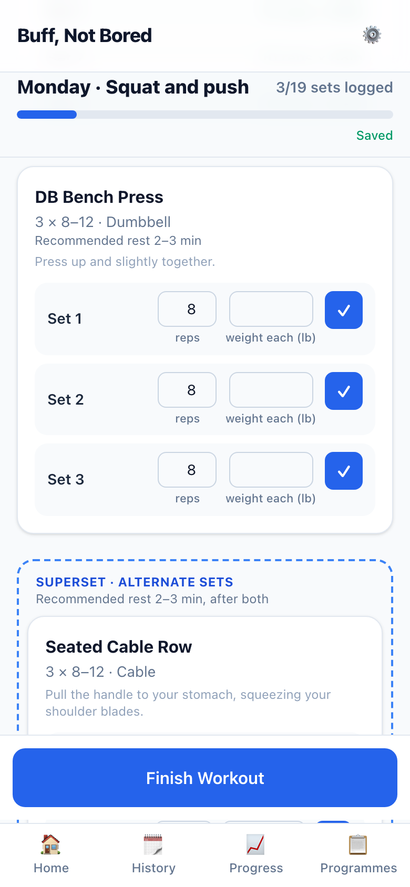
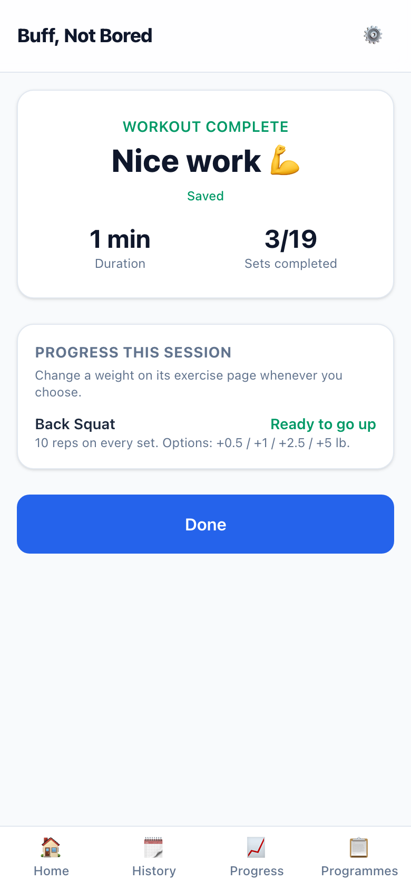
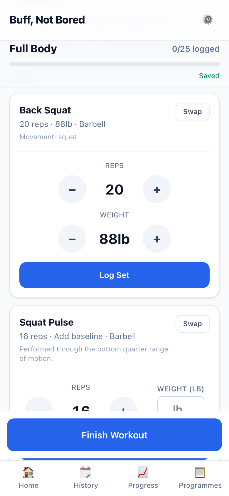
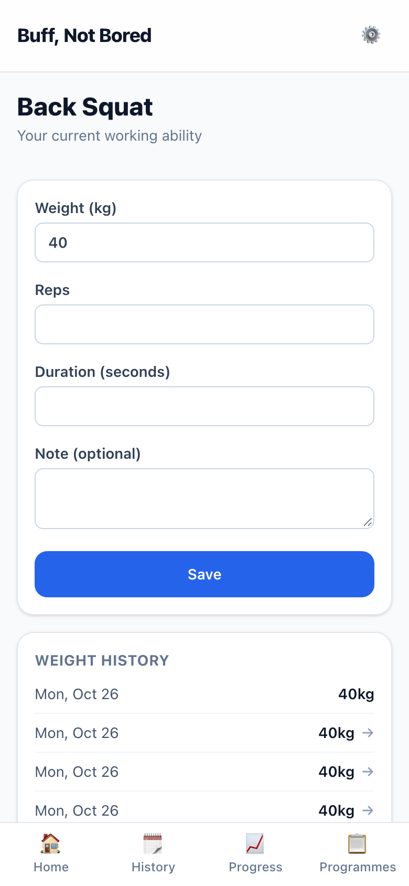

# S-006 · kg or lb, chosen in Settings

## What was built
- **A Settings page.** The ⚙️ button now opens Settings, with **Units: Kilograms (kg) / Pounds (lb)** and a link to **Exercises**. The choice is saved in the database, so your phone and laptop agree.
- **Every weight follows your choice:**
  - Strength set labels ("weight (lb)", "weight each (lb)", "assistance (lb)") and logged sets ("10 reps × 88lb");
  - Circuit's weight control (taps of 5 lb for a barbell, 1 lb otherwise) and its first-use box;
  - the exercise page's weight box and weight history (the old per-exercise Unit dropdown is gone);
  - the "ready to go up" messages, with lb jumps of +0.5 / +1 / +2.5 / +5 lb;
  - the "couldn't save your weight" message.
- **Nothing saved changes.** Weights stay stored in kg; lb is only how they're shown and typed. A weight left as it was and logged back keeps its exact value.
- **lb moves in 0.5 lb steps**, and a weight typed in lb is stored precisely enough to stay exactly what you typed (D-015).

## Screenshots (390 × 844, in flow order)

| | |
|---|---|
|  | **01 · Settings** (from ⚙️), in kg, with Exercises linked below. |
|  | **02 · Switched to lb.** |
|  | **03 · Strength in lb.** Back Squat first-use entered as 88 lb; logged "10 reps × 88lb". |
|  | **04 · Dumbbells:** "weight each (lb)". |
|  | **05 · Summary in lb:** "Options: +0.5 / +1 / +2.5 / +5 lb." |
|  | **06 · Exercise page in lb:** "Weight (lb)", history in lb, no unit dropdown. |
|  | **07 · Circuit in lb:** "88lb" with +/− taps of 5 lb. |
|  | **08 · Back in kg:** the same squat reads 40 kg. |

## Deviations and things to know
- **A weight entered in lb shows to the nearest 0.25 kg when you switch to kg.** For example, 88 lb reads as 40 kg; it's stored as 39.916 kg, and switching back to lb shows 88 lb again.
- **Fixed along the way:**
  - Typing 0 or a negative weight on the exercise page used to clear your saved weight quietly. It now shows an error instead.
  - Weight-history arrows compare what you see, so two entries that read the same never show an up or down arrow.
- **If the database can't be reached**, the app shows kg rather than failing every page.
- Set logging is still the design-first skeleton; only its labels changed.

## Questions for you
None.
